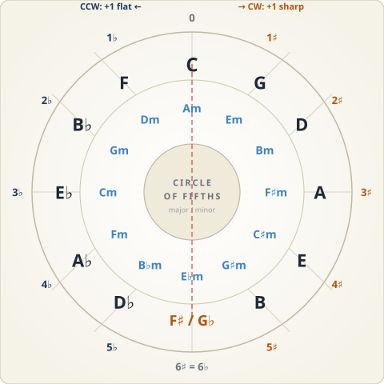
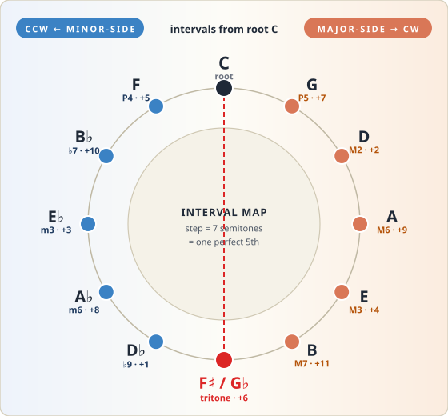
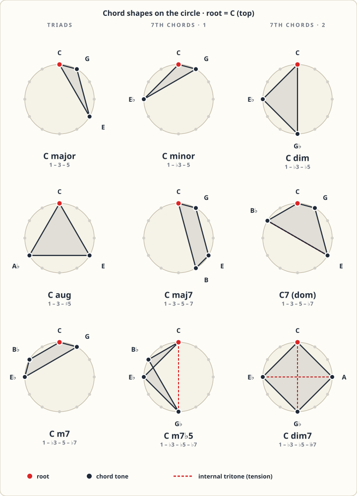
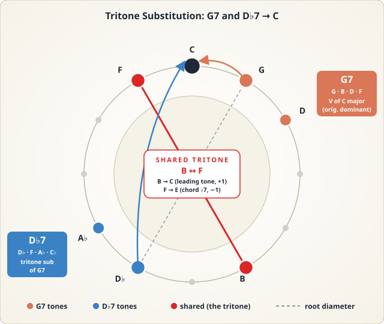
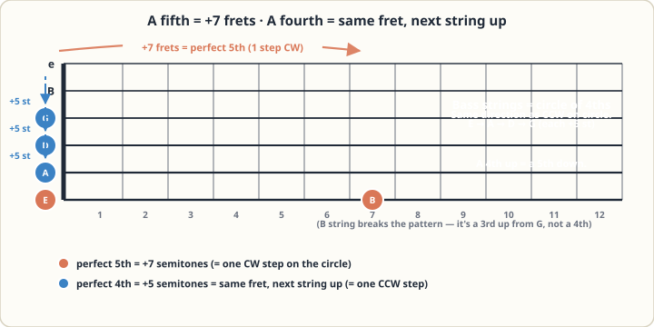
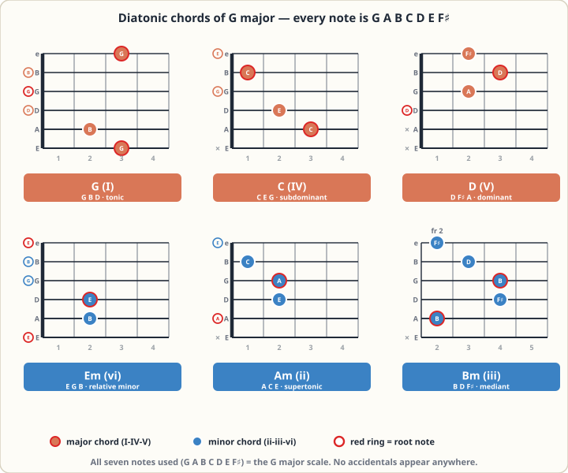
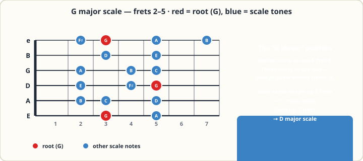
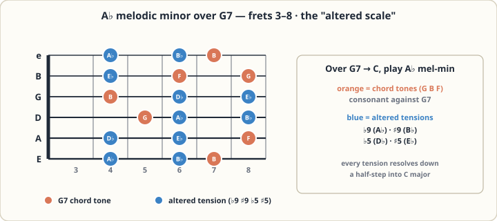

# Circle of Fifths (Guitar)

## Why This Exists

**Problem.** You can play chords but don't know *why* a song moves G → C → D, why "Wonderwall" is in Em but the chords look like G/D/Am, or how to transpose a song up two steps for a singer. Theory feels like a separate universe from the fretboard.

**Key insight.** Stack perfect fifths — the most consonant interval after the octave — and after 12 jumps you land back where you started. That single loop encodes: every key signature, every diatonic chord family, every smooth modulation, every relative minor, and the V→I pull that drives almost all Western music.

**Reach for this when:**
- You want to know what chords belong in a key (and which ones don't).
- A capo conversation comes up ("what key is capo 3 in G shape?").
- You're transposing a song or writing a chord progression.
- You see roman numerals (I, IV, V, vi) and want them to click.
- You're memorizing the order of sharps/flats for sight-reading.
- You're improvising and need to find the "home note" by ear.

**Don't reach for this when:**
- You're learning a specific song's mechanics — tab and ear are faster.
- You're working in modal or jazz harmony (modal interchange, tritone subs) — the circle is the *starting* map, not the full territory.
- You just need a chord shape — that's a chord chart, not theory.

## Diagrams

### 1. The wheel — major key / relative minor / key signature



### 2. Interval map — same wheel, labeled from a root note (C)



> **Read it like this:** the warm (right) half holds the major-flavored intervals (P5, M2, M6, M3, M7); the cool (left) half holds the minor-flavored ones (P4, ♭7, m3, m6, ♭9). The red diameter is the tritone — opposite the root, no side, maximum tension.

#### Four things the interval map secretly encodes

**1. Inversion = mirror across the root–tritone axis.** Every interval and its octave-complement (they sum to 12 semitones) sit at mirrored positions on the map. P5 (+1 CW) mirrors P4 (−1 CCW); M3 (+4 CW) mirrors m6 (−4 CCW); M7 (+5 CW) mirrors m2 (−5 CCW). The tritone (+6) is *self-inverse* — its own mirror — which is the structural reason it sits dead opposite the root with no side. Inversion isn't a separate concept to memorize; it's just folding the map.

**2. Brightness axis: CW = bright, CCW = dark (literally).** Each CW step from the tonic *raises* one scale note by a semitone; each CCW step *flats* one. Stacking these moves produces the seven modes in order of brightness — same set of notes, different home base:

```
brightest  →  Lydian      (raised 4)
              Ionian      (major)
              Mixolydian  (♭7)
              Dorian      (♭3, ♭7)
              Aeolian     (natural minor: ♭3, ♭6, ♭7)
              Phrygian    (♭2, ♭3, ♭6, ♭7)
darkest    →  Locrian     (♭2, ♭3, ♭5, ♭6, ♭7)
```

So **how many CW vs. CCW notes a scale contains literally measures its brightness.** A Lydian solo over a major chord sounds "lifted" because every accidental is on the CW side; a Phrygian solo sounds dark because they're all on the CCW side.

**3. The map *generates* a major scale.** A major scale is **seven consecutive CW positions** starting one step CCW of the tonic. For C major:

> F (−1) · C (0) · G (+1) · D (+2) · A (+3) · E (+4) · B (+5)

Re-sort those by pitch and you have C–D–E–F–G–A–B — the C major scale, derived purely from circle positions, no memorization. The five leftover slots {F♯, C♯, G♯, D♯, A♯} form the F♯ major pentatonic — the piano's black keys. The map isn't a lookup table; it's a *generator* for scales, modes, and key signatures.

**4. Distance on the map = how related two keys are.** Every major key uses exactly **7 notes** — its scale. C major = `C D E F G A B`. G major = `G A B C D E F♯`. Lay them side-by-side:

| Note in C major | Same note in G major? |
|---|---|
| C | ✓ C |
| D | ✓ D |
| E | ✓ E |
| **F** | ✗ — G major has **F♯** instead |
| G | ✓ G |
| A | ✓ A |
| B | ✓ B |

**Six of the seven notes are identical. Only one note differs** (F flips to F♯). That's what "share 6 of 7 scale notes" means — and it's no accident: one CW step on the circle of fifths *mechanically* raises one note of the previous key by a semitone (the old key's 4th degree becomes the new key's 7th, the leading tone). One circle step = one altered note.

Walk further around the circle and the count of altered notes climbs in lockstep:

| Circle steps apart | Notes shared with C major (out of 7) | Notes that changed | Modulation feel |
|---|---|---|---|
| **1** (C ↔ G)  | 6 — {C D E G A B} | F → F♯           | smooth, near-invisible |
| **2** (C ↔ D)  | 5 — {D E G A B}   | F → F♯, C → C♯   | smooth |
| **3** (C ↔ A)  | 4 — {E A B} + D from C-major minus C... | F→F♯ C→C♯ G→G♯ | noticeable shift |
| **6** (C ↔ F♯) | 2 — {B, F=E♯ enharmonically} | every other note | maximally distant — the "tritone modulation" used for shock (bridge of *Sweet Child O' Mine*, B section of *Maria* from West Side Story) |

**Why this matters in practice:** modulation feels *smooth* exactly when the two keys share many notes, because the listener's ear is already comfortable with most of the new key's pitch material — only one or two notes feel "new." That's also why **pivot chords** work: a chord that exists in both keys lets you slip from one to the other without any note feeling foreign. Adjacent circle positions have the most pivot-chord candidates (because they share 6 notes, hence ~5 in-common chords); opposite positions have almost none, which is why a tritone modulation jolts the ear.

### 3. Chord-shape matrix — which clock positions light up



> **Compare the shapes at a glance.** Same root (C) on top of every mini-wheel. Major / minor are the *same* triangle, mirrored across the vertical axis (3rd flips side). Augmented is an equilateral triangle, dim7 is a perfect square — those polygons explain why only 4 distinct aug chords and only 3 distinct dim7 chords exist in all of music. Any shape whose vertices straddle the diameter (red dashed line) contains a **tritone** and therefore *wants to resolve* — that's the defining feature of dominant 7, m7♭5, and the diminished family.

### 4. Tritone substitution — diameter twins resolving to the same place



> **The whole substitution in one picture.** G7 and D♭7 sit at opposite ends of the circle (their roots are a tritone apart — gray dashed diameter). But the *upper* tritone — B and F (red diameter) — belongs to both chords. That shared B–F is what resolves to C: B climbs to C, F drops to E. Either chord delivers the same payload to the tonic, which is why one can stand in for the other.

## How the Loop Works (Intuition First)

### Why fifths form a closed cycle

A "perfect fifth" up means multiplying frequency by 3/2 (or going 7 semitones up on the fretboard — the distance from the open low E string to the 7th-fret B). If you keep stacking 3/2 ratios you'd never return to a perfect octave (that's the *Pythagorean comma*), but in **12-tone equal temperament** — what every fretted guitar uses — each fret is exactly the 12th root of 2, and 7 × 12 ≡ 0 (mod 12), so 12 fifths land back on the start note. That's why the circle has exactly 12 positions.

On the fretboard, "up a fifth" has a memorable shape: same fret, **one string higher** (skipping the B string adjustment). E → A → D → G are all fourths *up* (= fifths *down*), which is why the bass strings of the guitar are tuned in fourths and trace the circle counter-clockwise. This is not coincidence — the tuning *is* a circle-of-fourths slice.

### See it on the neck



> **What to look at.** The orange dots span the low E string from open to fret 7 — that's the literal **+7 semitones = perfect fifth** the math demands. The blue dots are the *open* A, D, and G strings: each one is a perfect fourth above its neighbor, which is the *same thing* as a fifth below (one CCW step on the circle). The bass half of your guitar is geometrically a slice of the circle of fifths — that's why fingering patterns translate so naturally between adjacent strings.

### Why clockwise = sharps, counter-clockwise = flats

Each step clockwise raises one note of the previous key by a semitone — specifically, the 7th degree, which becomes the new key's leading tone. Starting from C major (all naturals):

| Key | Sharps added | Order |
|-----|--------------|-------|
| C   | —            | none |
| G   | F#           | 1 |
| D   | F# C#        | 2 |
| A   | F# C# G#     | 3 |
| E   | F# C# G# D#  | 4 |
| B   | + A#         | 5 |
| F#  | + E#         | 6 |

**The mnemonic: sharps appear in the order F# C# G# D# A# E# B# — which is itself fifths going up.** Flats reverse it: Bb Eb Ab Db Gb Cb Fb — fifths going down (or fourths going up).

Sharp-key trick: the last sharp is always one semitone below the tonic. Three sharps (F# C# G#) → last sharp is G# → tonic is A.
Flat-key trick: the second-to-last flat *is* the tonic. Three flats (Bb Eb Ab) → second-to-last is Eb → key is Eb.

## Diatonic Chords from the Circle

In every major key, the seven diatonic chords follow a fixed quality pattern:

```
I    ii    iii   IV    V    vi   vii°
maj  min   min   maj   maj  min  dim
```

The circle gives you the three majors (I, IV, V) **at a glance**: the I is your starting position, IV is one step *counter-clockwise*, V is one step *clockwise*. The relative minor (vi) is directly inside the wheel.

Example — key of G:
- One CCW from G → **C** = IV
- One CW from G → **D** = V
- Inner ring at G → **Em** = vi
- ii is the inner ring at IV → **Am**
- iii is the inner ring at V → **Bm**
- vii° is between V and the inner ring at IV → **F#dim**

So G major's diatonic chords are: **G, Am, Bm, C, D, Em, F#dim**. That's "Wonderwall," "Sweet Home Alabama," "Let It Be," and about 80% of campfire songs.

### What "in the key of G" actually looks like on the neck

The six main chords (I, ii, iii, IV, V, vi) drawn as open-position chord boxes. Every dot is one of the seven notes of **G major: G A B C D E F♯**. No accidentals appear anywhere — that's literally what "diatonic to G" means.



> **What to look at.** Every dot on every fretboard is one of *seven* notes — G, A, B, C, D, E, F♯. No sharps or flats outside that set show up, which is the literal meaning of "diatonic to G." Warm orange = the I–IV–V majors (the three CW-adjacent positions on the circle); cool blue = the ii–iii–vi minors (their relative-minor partners). Switch any two of these chords in any order and you've written a song in G.

### Common progressions, decoded

| Roman numerals | In G | In C | What it does |
|---|---|---|---|
| I–V–vi–IV | G–D–Em–C | C–G–Am–F | The "pop punk" / "Don't Stop Believin'" loop |
| I–IV–V | G–C–D | C–F–G | 12-bar blues, three-chord rock |
| ii–V–I | Am–D–G | Dm–G–C | The jazz cadence; strongest resolution |
| vi–IV–I–V | Em–C–G–D | Am–F–C–G | Same chords as I–V–vi–IV, starts on the minor |
| I–vi–IV–V | G–Em–C–D | C–Am–F–G | '50s doo-wop |

Every one of these is **adjacent positions on the circle**. That's the magic: smooth voice leading lives in neighboring slots.

## Chord Construction on the Circle

The previous section showed *which chords* live in a key. This one zooms in: how the *notes inside each chord* sit on the circle. Same map, different scale.

### The interval map (every interval = a circle distance)

Each CW step on the circle = 7 semitones = one perfect fifth up. Mod 12, that means every interval from the root is just "N steps clockwise":

| Interval up from root | Semitones | Steps on circle | Example from C |
|---|---|---|---|
| Perfect 5th (P5) | 7  | **+1 CW** | G |
| Perfect 4th (P4) | 5  | **−1 CCW** (= +11) | F |
| Major 2nd (M2)   | 2  | +2 CW | D |
| Major 3rd (M3)   | 4  | **+4 CW** | E |
| Minor 3rd (m3)   | 3  | **−3 CCW** | Eb |
| Major 7th (M7)   | 11 | **+5 CW** | B |
| Minor 7th (b7)   | 10 | **−2 CCW** | Bb |
| Tritone (b5/#4)  | 6  | **+6 = −6** (opposite) | F# / Gb |
| Major 6th (M6)   | 9  | +3 CW | A |
| Minor 6th (m6)   | 8  | −4 CCW | Ab |

Pattern: **major-flavored intervals fall short-CW; minor-flavored intervals fall short-CCW; the tritone sits exactly across the diameter.**

> **Quick check on the intuition that started this section:** "Go back from C = the 4th (F); go forward = the 5th (G)." That's correct as a *single-interval* claim and gives you the I–IV–V *family* (three chord roots) in a key. But a single major *chord* is 1–3–5, not 1–4–5 — to actually build C major you also need E, which is **+4 CW**, not the immediate neighbor. Chord-roots-in-a-key and chord-tones-in-a-chord are two different uses of the circle.

### Triads

Each triad = three positions on the circle. Plot them; the family resemblance pops out.

**Major (1 — 3 — 5)** → positions **{0, +1 CW, +4 CW}**
- C major = **C, G, E**.
- A "fan" opening CW: the 5th sits next-door; the 3rd jumps four CW.

**Minor (1 — b3 — 5)** → positions **{0, +1 CW, −3 CCW}**
- C minor = **C, G, Eb**.
- Same as major, **but the 3rd flips to the CCW side.** That single mirror across the root–fifth axis *is* the major/minor distinction.

On the fretboard, that "3rd flip" is one finger moving by one fret. Watch:


> **What to look at.** Every note on the neck is identical between the two chords *except* the red one on the B string. In C major it sits on fret 5 (E, the natural 3rd); in C minor it sits on fret 4 (E♭, the flat 3rd). One finger moves one fret backward — that's the entire major-to-minor transformation. Every Western emotional shift between bright and dark, joy and grief, runs through this one-fret move.

**Diminished (1 — b3 — b5)** → positions **{0, −3 CCW, +6}**
- C° = **C, Eb, Gb**.
- The 5th is swapped for the tritone (opposite the root). No "home side" — the tritone is unstable, which is exactly why dim chords push for resolution.

**Augmented (1 — 3 — #5)** → positions **{0, +4 CW, +8 CW (= −4 CCW)}**
- C+ = **C, E, G#**.
- Three notes spaced 4 steps apart — an **equilateral triangle** inscribed in the circle. Only **four** distinct augmented chords exist, because rotating the triangle lands on the same notes.

### Seventh chords (just add the 7th degree)

**Dominant 7 (1 — 3 — 5 — b7)** → **{0, +1, +4, −2}**
- C7 = C, E, G, Bb.
- The M3 (+4) and b7 (−2) are exactly **6 steps apart** — a **tritone**. *That* tritone is the engine of dominant function: in G7 → C, the B wants to climb to C and the F wants to drop to E, both by half-step.

**Major 7 (1 — 3 — 5 — 7)** → **{0, +1, +4, +5}**
- Cmaj7 = C, E, G, B.
- The M7 (+5) sits right next to the M3 (+4). All four tones cluster on the CW side — lush, calm, **no tritone**.

**Minor 7 (1 — b3 — 5 — b7)** → **{0, +1, −3, −2}**
- Cm7 = C, Eb, G, Bb.
- Mirror image of Cmaj7's cluster on the *CCW* side, plus the same +1 fifth.

**Half-diminished / m7b5 (1 — b3 — b5 — b7)** → **{0, −3, +6, −2}**
- Cm7b5 = C, Eb, Gb, Bb.
- m7 with the 5th flattened to the tritone. Functions as the **ii in a minor key**: in A minor, Bm7b5 → E7 → Am is the classic minor ii–V–i.

**Fully diminished 7 (1 — b3 — b5 — bb7)** → **{0, −3, +6, +3}**
- C°7 = C, Eb, Gb, A (bb7 = enharmonic M6).
- **Four positions, every 3 steps apart — a perfect square inscribed in the circle.** Because of that symmetry there are only **three** distinct dim7 chords; rotating the square lands on the same four pitches.

### Shape-on-the-circle comparison

Picture the C-rooted chord with **C at 12 o'clock**, and the other tones plotted around the dial:

```
Chord     Circle positions (relative to root at 0)    Geometric shape
─────────────────────────────────────────────────────────────────────
Major     {0, +1, +4}              CW fan (root + 5th + far M3 CW)
Minor     {0, +1, −3}              CCW-mirror of major (3rd flips side)
Aug       {0, +4, +8}              equilateral triangle (4 chords total)
Dim       {0, −3, +6}              minor triad with the 5th flung to opposite side
Maj7      {0, +1, +4, +5}          tight CW cluster, no tritone
Dom7      {0, +1, +4, −2}          M3 + b7 form the tritone (the tension)
m7        {0, +1, −3, −2}          minor triad + b7 (parallel to dom7, 3rd flipped)
m7b5      {0, −3, +6, −2}          half-dim — m7 with 5th flattened to tritone
dim7      {0, −3, +6, +3}          square — only 3 distinct chords exist
```

**The whole logic in one line:** flipping the 3rd's direction (CW ↔ CCW) is major ↔ minor; replacing the 5th with the diameter point (+6) is *5 → b5* (diminished family); adding the −2 CCW slot is *adding the b7* (dominant / minor-7 / half-dim family); the +5 CW slot is the *major 7th* (only mixes with major).
## Scales and Progressions — How to Solo Over Chords

A scale is a *menu of notes that match*. A chord is a *snapshot* of three or four of those notes ringing together. A progression is a sequence of those snapshots. Soloing = walking the scale while the snapshots underneath you change. Here's the operating manual.

### The one-scale rule for major keys

> **A song in the key of G major → solo using the G major scale.**

That single sentence covers ~80% of pop, folk, country, rock, and blues. Every diatonic chord in G — G, Am, Bm, C, D, Em, F♯dim — is built **entirely from notes in the G major scale**. So whatever chord is underneath you, every note of G major is "safe."

The reason works through the circle: those seven chords use only the seven notes G A B C D E F♯ (no accidentals). The scale contains every chord tone of every diatonic chord, so you can't actually leave the harmony as long as you stay in the scale.

### The G major scale on the neck (position 2 — "the G shape")



> Memorize **one** box like this and you can play any major key — the shape is movable. The whole pattern translates as a rigid unit; only the starting fret changes. Same shape at fret 3 = G major; fret 8 = C major; fret 10 = D major.

### Applying scale to chord — three levels of targeting

The scale is *safe* but not *strong*. The art is choosing **which note of the scale to land on when each chord plays**. Three levels of sophistication:

**Level 1 — Stay in the scale, ignore the chord.** Play any G-major note over any G-major chord. It will sound fine and never "wrong." This is how most beginning lead playing works, and it's perfectly listenable. The harmony does the work for you.

**Level 2 — Target chord tones on the downbeat.** When the chord changes, *land on a note from that chord* on beat 1. The other beats can drift through the scale. Example over a `G – C – D` progression:

```
Chord:    G       |  C        |  D       |  G
Land on:  G/B/D   |  C/E/G    |  D/F♯/A  |  G/B/D
Fill with: any G-major notes in between.
```

This is what makes a lead line feel **melodic** rather than scalar. You're not "shredding the scale" — you're outlining the chord progression with melody. Bach, the Beatles, and Stevie Wonder all do this. It's the single biggest jump in expressiveness.

**Level 3 — Target the moving voice.** When the chord changes, identify the *one note that's actually new* and land on it. Going from G to C, the new note is C (G shares G and B with C major). Landing on C the moment the chord hits C makes the change feel inevitable. This is "voice leading" at the soloist's level.

### Putting it together: a worked example

Say a song loops `G – Em – C – D` (a I–vi–IV–V — the same chords as *Mr. Brightside*, *Take On Me*, and hundreds of others). Here's what each level sounds like:

| Bar | Chord | L1 (scale only) | L2 (target chord tone) | L3 (target the change) |
|---|---|---|---|---|
| 1 | G  | any G-major notes | land on G or B  | land on G  (still I)        |
| 2 | Em | any G-major notes | land on E or G  | land on **E**  (new note)    |
| 3 | C  | any G-major notes | land on C or E  | land on **C**  (new note)    |
| 4 | D  | any G-major notes | land on D or F♯ | land on **F♯** (the leading tone — pulls back to G) |

Every level uses the **same seven notes**. The difference is *which note arrives on each beat 1.* That single choice is what separates "noodling" from "soloing."

### Minor keys — same notes, different home

A minor key is the *vi degree* of its relative major elevated to "home." E minor and G major share the same 7 notes (G A B C D E F♯); the difference is where the gravity lives. So:

> **Song in E minor → solo with the E natural minor scale.**

E natural minor is the **same fretboard shape as G major**, just renamed with E as root. The diatonic chords come from the same circle slice (one CCW step from G, then 4 CW steps), now relabeled:

| Roman numeral | Quality | In E minor |
|---|---|---|
| i        | min | Em |
| ii°      | dim | F♯dim |
| ♭III     | maj | G |
| iv       | min | Am |
| v        | min | Bm |
| ♭VI      | maj | C |
| ♭VII     | maj | D |

Notice the v chord is a **minor** (Bm), not a dominant. That's why pure natural minor songs feel modal and "unresolved" — there's no leading tone pulling back to the tonic. Which leads to…

### The three minor scales

Minor isn't one scale, it's three — each fixes a specific weakness of natural minor.

| Scale | Notes (E root) | What it fixes | When to use |
|---|---|---|---|
| **Natural minor** (Aeolian) | E F♯ G A B C D | (baseline)    | Folk, rock, modal pop. Gives the moody, "no V→i pull" feel |
| **Harmonic minor**          | E F♯ G A B C **D♯** | Raises the 7th → creates a *leading tone* and lets you build a dominant V7 (B7) over the v position | Flamenco, classical minor, anywhere you want a strong V7→i cadence in a minor key |
| **Melodic minor** (jazz form, asc + desc) | E F♯ G A B **C♯ D♯** | Raises both 6 and 7 → fixes the awkward augmented-2nd interval in harmonic minor (between ♭6 and ♯7) | Jazz; modern soloing over minor chords; the parent of several "altered" scales |

A useful way to think about melodic minor: **it's a major scale with a flat 3rd**. Compare E melodic minor (E F♯ G A B C♯ D♯) to E major (E F♯ G♯ A B C♯ D♯) — only one note different. That's why melodic minor sounds "ambiguous" — three of its four upper notes are major-key brightness, while the ♭3 keeps the minor flavor.

### Melodic minor: two jazz applications

Melodic minor earns its keep beyond minor-key songs. Two specific tricks every jazz player learns:

**Trick 1 — Altered scale over a V7 (the famous one).** In C major, when **G7 → C**, instead of playing G mixolydian (the "in-key" scale for G7), play **G♯ melodic minor** (= A♭ melodic minor, enharmonic spelling).

Why it works: A♭ melodic minor = A♭ B♭ C♭ D♭ E♭ F G. Against G7 (G B D F):

| A♭ mel-min note | Spelled vs. G | Role over G7 |
|---|---|---|
| **G**  | root         | chord tone |
| A♭     | ♭9          | altered tension |
| B♭     | ♯9          | altered tension |
| **C♭ (=B)** | 3      | chord tone |
| D♭     | ♭5 / ♯11    | altered tension |
| E♭     | ♯5 / ♭13    | altered tension |
| **F**  | ♭7          | chord tone |

You get **3 of G7's chord tones** (G, B, F — including the resolving tritone B↔F) plus **all four altered tensions** (♭9, ♯9, ♭5, ♯5). Played over G7 → C, every alteration screams to resolve down a half-step to a C-major chord tone:

- A♭ → G (resolves to the 5 of C)
- B♭ → A (resolves to the 13 of C, or moves up to B as the 7)
- D♭ → C (resolves to the root!)
- E♭ → E (resolves to the 3rd of C)

That's why this scale is called the **altered scale** (or "Super Locrian") and why it's the single most common scale-over-V7 choice in jazz.



> **Why melodic minor and not "G altered"?** Because they're the same notes — just relabeled. Calling it "A♭ melodic minor" lets you fall back on a shape and fingering you already practice. The melodic-minor parent scale is the most economical way to memorize all seven modes-of-melodic-minor (altered, Lydian-♭7, Locrian-♮2, etc.). Learn one shape, deploy seven sounds.

**Trick 2 — Melodic minor over iv minor (the "Beatles ballad" sound).** In C major, the iv chord borrowed from C minor is **Fm**. Over that Fm, play **F melodic minor** = F G A♭ B♭ C D **E**. The 7th degree is **E natural**, the major 7 of F — and crucially, E is also **the major 3rd of C**.

So when the progression moves `Fm → C`:

- During Fm: play F melodic minor; **land on E** as the chord settles. Against Fm, the E is the major 7 — a sweet, longing tension.
- When the chord changes to C: that same E becomes the chord 3 of C major. Smooth common-tone landing — no need to move your finger.

That's the trick the user is asking about. The whole sequence sounds like *"Yesterday"*, *"Norwegian Wood"*, or the bridge of *"While My Guitar Gently Weeps"* — that bittersweet "borrowed minor that leans home" feeling. Mechanically it's just: when the chord is iv-minor, raise the 6th and 7th of natural minor, then resolve to the I.

A useful generalization: **any minor chord borrowed from the parallel minor key (iv, ii°, ♭VI, etc.) can be soloed with melodic minor built off that chord's root.** Doing so adds the major 7 of that chord, which is often a chord tone of the I — giving you built-in voice leading back home.

### When you can leave the major scale

The G-major-scale-over-G-key rule covers the diatonic case. Three common exceptions:

- **Blues in G** — use the **G minor pentatonic** (G B♭ C D F) over major chords for the "bluesy" rub. The B♭ and F are *outside* G major; they create the characteristic blue notes against the major harmony. Many guitarists toggle between G major pentatonic and G minor pentatonic in real time.
- **Secondary dominants** — when an unexpected dominant 7 appears (like `A7` in a song in C major, leading to Dm), borrow notes from that chord momentarily. A7 contains C♯, which isn't in C major — but for the one bar A7 is playing, treating it as "the dominant of D" gives you a temporary D-minor scale to draw from.
- **Modal interchange chords** — if the song borrows from G minor (like a bVII = F major or iv = Cm), use the G *minor* scale over those bars. Switch back to G major when the borrowed chord ends.

### How the circle informs your scale choice

Here's the meta-rule that ties everything in this note together: **the scale you solo with should match the section of the circle the chords live in.** All diatonic chords sit within 5 adjacent circle positions (one CCW + tonic + three CW). The major scale is *exactly* those 7 notes. So:

| The chords are clustered in… | Use this scale |
|---|---|
| 5 consecutive circle positions, major tonic | major scale of that tonic |
| 5 consecutive circle positions, minor tonic (vi-centered) | natural minor scale of that tonic |
| Reaches one CCW step further (adds bVII) | Mixolydian or major-with-bVII |
| Reaches one CW step further (adds ♯4) | Lydian |
| Spans more than 6 positions | the song is modulating — switch scales when the chords switch zones |

Scale choice isn't a separate skill from harmony — it's **the same circle, read horizontally instead of vertically**. The chord tells you *which* slice of the circle is sounding right now; the scale tells you *which seven notes* fill in around it.

## V → I: The Engine

The single most important relationship in tonal music is **V resolving to I** — a fifth dropping to its root. In G, that's D → G; the F# in D (the 3rd) is a semitone below G (the leading tone), and the ear demands that resolution. This is why nearly every song ends on the I, usually preceded by the V.

The circle is literally a *chain of V→I* resolutions. Starting at any position and going one step counter-clockwise *is* a V→I move. That's why ii–V–I works: you're walking three steps counter-clockwise (Am → D → G in G major), three V→I pulls in a row, each landing you closer to home.

### On the neck: the V→I pull as finger motion

The resolution `G7 → C` is two single-fret moves happening simultaneously. The leading tone climbs by one fret; the chord seventh releases by one fret. See it on the strings:


> **The lesson.** Every dominant 7 → tonic move on the guitar is *literally* two fingers each sliding by one fret in opposite directions. That's the half-step pair physical music theory talks about — and it's the exact same machinery whether you're playing folk, blues, jazz, or pop. The B–F tritone inside G7 doesn't just *want* to resolve; it gives your fingers the easiest possible path home.

## Tone Substitution (Why the Circle Predicts What Sounds Right)

Substitution = replacing one chord with another that **shares enough notes / function** to feel like the same move. The circle exposes *why* the swap works because shared-circle-distance ≈ shared-pitch-content.

### 1. Tritone substitution (the classic)

**Rule.** Any dominant 7 can be replaced by the dominant 7 a tritone away (the chord directly across the circle).

- G7 = G, B, D, F. The pulling tritone is **B–F**.
- **Db7** = Db, F, Ab, **B** (=Cb). The tritone is **F–Cb**.
- Same two notes (B and F) — *that's the same tritone, just relabeled*. Both chords beg to resolve to **C major** with B→C and F→E.

Result: `Dm7 — G7 — Cmaj7` (ii–V–I) becomes `Dm7 — Db7 — Cmaj7`. The bassline now walks **chromatically down** (D → Db → C) and the resolution still lands. This is the single most-used reharmonization in jazz.

**Circle picture.** G and Db are **exactly opposite** (+6 / −6). The two tritone-sub partners are always diameter twins.

### 2. Diatonic substitution (relative neighbors)

Within a key, chords that share two of three notes are interchangeable:

| Sub | Replaces | In C | Why |
|---|---|---|---|
| iii  | I    | Em ↔ C   | Em = E, G, B; C = C, E, G — two shared tones |
| vi   | I    | Am ↔ C   | Am = A, C, E; C = C, E, G — two shared tones |
| vi   | IV   | Am ↔ F   | Am = A, C, E; F = F, A, C — two shared tones |
| ii   | IV   | Dm ↔ F   | Dm = D, F, A; F = F, A, C — two shared tones |
| vii° | V7 (no root) | Bdim ↔ G7 | Bdim = B, D, F = the upper three notes of G7 |

**Circle picture.** Diatonic substitutes are **always adjacent** on the wheel (chord ↔ its inner-ring partner, or chord ↔ next-door slot). Adjacency on the circle = maximal note overlap.

### 3. Secondary dominants ("V of V" etc.)

Any chord can be approached by *its own* V — borrowed from outside the key. The circle shows this as **prepending one CW step** to the target.

- In C major, V = G. **V of V** = the dominant of G = **D7**. So `D7 — G — C` is "tonicizing" G before resolving home. D is one CW from G; G is one CW from C — you're just walking three positions CCW around the circle.
- In C major, **V of vi** = E7 → Am (E is one CW from A on the circle).

### 4. Backdoor dominant (the bVII7 trick)

Instead of resolving via V→I (one CCW step), resolve via **bVII7→I** (two CCW steps + an unexpected b7 swap).
- In C: Bb7 → C. Bb7 shares two notes with Fm6 and with the tritone-sub of E7 — it sneaks in *through* the subdominant side of the circle. Heard in jazz endings and a lot of Steely Dan.

### 5. Modal interchange (parallel-key borrowing)

Swap a chord for its parallel-minor equivalent — same root, opposite-side tonality.
- In C major, borrow **Fm** from C minor: `C — Fm — C` (Coldplay's "Yellow," lots of Beatles).
- On the circle: C major lives in the no-sharps/no-flats slot; C minor sits **3 steps CCW** (three flats). Borrowed chords show up where those two key-zones overlap. The **bVII (Bb), bIII (Eb), bVI (Ab), iv (Fm)** are the four common loans — all are clustered on the CCW side of C.

### 6. Why all five sub-types work for the same reason

Every substitution above is some flavor of: *replace a chord with one whose tones live nearby on the circle (so most pitches are kept) or whose tritone matches (so the pull is kept)*. The circle is literally a **pitch-proximity map**, so substitutions that work musically also work geometrically — they're either:

- **Adjacent** (diatonic, secondary dominant, modal interchange) → shared note content
- **Diameter-opposite** (tritone sub) → shared tritone, opposite roots

Once you see it that way, you don't memorize subs — you read them off the wheel.

## Relative Minor and Modal Cousins

The relative minor shares the **same key signature** but starts on the 6th degree of the major scale. Em is the relative minor of G — both have one sharp (F#), both use the same seven notes, but Em-centered music *feels* sad/dark because the tonic is now Em, and the V→i pull is now Bm → Em (or B7 → Em if you want the leading tone).

This is why songs like "Stairway to Heaven" (Am, key signature of C) and "House of the Rising Sun" (Am, also no sharps/flats) feel related to C major songs — they share an alphabet. Switching between a major key and its relative minor mid-song is one of the cheapest, most powerful moves in songwriting.

## Guitar-Specific Shortcuts

### Tuning *is* the circle (in fourths)

Standard tuning E–A–D–G–B–E: the bottom four strings go up by a perfect fourth each — which means they go *counter-clockwise* around the circle. The B string breaks the pattern (it's a third above G, not a fourth) so the high strings get a different shape, but the principle holds: many of your scale and chord fingerings *are* circle moves baked into geometry.

### CAGED and key transposition

The five CAGED shapes (C, A, G, E, D) cover the fretboard. Combined with the circle, transposing a song is mechanical: count fifths between source and target, and either capo or shift shapes.

Example: a song is in G but the singer wants it in A. A is one fifth above G (one step CW on the circle), which is 2 semitones up. **Capo 2, play G shapes** — done. The circle told you "1 step clockwise = 2 frets."

### Reading dominant 7 and its tritone sub off the fretboard

Your intuition lines up exactly. Working in **C major** as home:

- **G7** is the V7. G is a P5 above C (7 frets up, or one CW step on the circle). G7 = **G  B  D  F**. The crucial bit is the **tritone B↔F** inside it — that's the engine asking to resolve.
- The tritone substitute is **D♭7** (= C♯7 — same frets on guitar, different spelling). D♭ is a P5 above G♭, which means it sits **directly across the circle** from G — exactly 6 steps away.
- D♭7 = **D♭  F  A♭  C♭**. The C♭ is enharmonically a B. So D♭7 contains the **same B and F** as G7 — same tritone, different root. Both chords resolve to C the same way: B → C (climbs a half-step) and F → E (falls a half-step).

So yes — relative to C as root, D♭ is the **♭2** (one fret above the root). The standard label for the tritone sub is therefore **♭II7**, and the substitution turns a ii–V–I into a **ii–♭II7–I** with a chromatic bass walk:

```
Functional name:   ii   V7   I            ii    ♭II7   I
Chord (in C):      Dm7  G7   Cmaj7   →    Dm7   D♭7    Cmaj7
Bass note:          D    G    C            D     D♭     C       <- chromatic descent
```

That chromatic D → D♭ → C bassline is *the* sonic signature of a tritone sub. Jazz players reach for it because it gets you to the I chord with the smoothest possible voice leading.

### How it actually sits on the neck (open-position shapes)

Both G7 and D♭7 use the same dominant-7 **shape** — the latter is just slid up the neck:

| Chord | Shape | Notes (low → high) | Tritone pair inside |
|---|---|---|---|
| G7  | `320001` (open G + add F on string 1, fret 1) | G B D G B F | **B–F**  (strings 5↔1) |
| D♭7 | `x4342x` (5th-fret A7 shape moved down to D♭) | — D♭ A♭ B F — | **B–F**  (strings 3↔2) |

If you fret both and listen, the **B and F notes ring in both chords** — that's why they swap-in cleanly for each other. The G or D♭ in the bass is what changes color; the upper tritone is what carries the function.

Drawn on the fretboard (frets 1–5, low E at top → high E at bottom):


> **What to look at.** Red dots = the shared tritone (B and F). In **G7** it lives on string 5 fret 2 (B) and string 1 fret 1 (F). In **D♭7** the *same two notes* live on string 4 fret 3 (F) and string 3 fret 4 (B, spelled C♭). The fingerings look different but the resolution machinery is identical — that's the geometric reality of "tritone substitution" on the neck.

### Bonus: secondary dominants on the fretboard

The same logic generalizes. To "tonicize" any chord temporarily, play **its** V7 (or its tritone sub) right before it. In C major:

| You want to land on | V7 of it | Tritone sub |
|---|---|---|
| C (I)        | G7  | D♭7 |
| Dm (ii)      | A7  | E♭7 |
| Em (iii)     | B7  | F7  |
| F (IV)       | C7  | G♭7 |
| G (V)        | D7  | A♭7 |
| Am (vi)      | E7  | B♭7 |

Every row is one CW circle-step away (the V7) or six CW steps (the tritone sub). On the guitar, this means inserting one dominant-7 shape before the target chord. `C — A7 — Dm — G7 — C` ("Five Foot Two" / "Last Night I Had the Strangest Dream") is exactly this trick: A7 is the V7 of Dm, even though A natural isn't in C major — it's a one-bar visit to D-minor land before resolving back.

### Finding the key of an unknown song by ear

1. Find the "home" note — the one the song keeps returning to and ends on. That's the tonic.
2. Listen for whether the resting chord is major or minor.
3. Position on circle = key signature = list of in-key chords.

Most songs you'll encounter are in **G, C, D, A, or E major** (and their relative minors Em, Am, Bm, F#m, C#m) because those keys lay well on the guitar's open strings.

## Trade-offs

- **The circle assumes tonal harmony.** It's a perfect map for ~95% of pop, folk, rock, country, blues, and classical. It is *not* the right map for modal music (much of jazz, Indian classical, folk modal tunes), atonal music, or anything that pivots on tritones rather than fifths.
- **It encodes diatonic, not chromatic.** Borrowed chords (e.g., the bVII in rock — F major in a G song), secondary dominants (D7 leading to G in C major), and modal interchange all live *off* the circle. The circle tells you what's *expected*; departures from it are where character lives.
- **Equal temperament hides the seam.** The Pythagorean comma is real — stacked acoustic fifths don't quite close. Fretted guitars hide this by compressing every fifth slightly flat. Worth knowing if you ever play with a violinist who *isn't* compressing.

## Common Pitfalls

- **Memorizing the circle as a static picture, not as a process.** If you can't *generate* it from "stack fifths from C," you'll forget it. Practice writing it from scratch every few weeks.
- **Confusing relative and parallel minor.** Relative minor of C = Am (same key sig, vi degree). Parallel minor of C = Cm (same root, different key sig — 3 flats). Mixing them up makes modal interchange opaque.
- **Treating ii–V–I as jazz-only.** It's everywhere — "Let It Be" (Dm–G–C in C), "Hey Jude" (the verse), and most country songs all use ii–V–I or its sibling IV–V–I.
- **Forgetting F# and Gb are the same fretboard position.** When transposing, swap to the easier-spelling enharmonic — they're the same notes on a fretted instrument.
- **Counting frets instead of fifths for transposition.** Both work, but the circle tells you *why* the new key has its specific chord set; semitone counting only gives you the new tonic.

## Decision Table

| Scenario | Use this | Not that | Why |
|----------|----------|----------|-----|
| "What chords are in key X?" | Circle: I = X, IV = one CCW, V = one CW, vi = inner ring | Memorizing chord lists per key | Three positions on the wheel give you the whole diatonic set |
| "Transpose this G-major song to A" | Capo or shift up one CW step (2 frets) | Re-deriving every chord | One circle step = one transposition delta |
| "What's the relative minor of D?" | Inner ring of D = Bm (vi of D major) | Counting "down a minor third" semitone by semitone | The inner ring labels it directly |
| "Why does V→I sound final?" | Circle: V is one CW from I, so resolving CCW = "coming home" by a fifth | Treating it as arbitrary convention | The fifth is the strongest interval after the octave |
| "Should I write F major in my G-major song?" | Off-circle = borrowed (modal mixture, bVII rock move) | Calling it a "wrong" chord | Off-circle chords are intentional color, not errors |
| Sight-reading key signatures | Sharp count → key via "last sharp + semitone = tonic" trick | Memorizing all 15 key sigs | The trick is two arithmetic steps and works every time |

## References

- [Circle of Fifths — Wikipedia](https://en.wikipedia.org/wiki/Circle_of_fifths) — canonical history, including Heinichen's 1728 diagram.
- [Key Signature — Wikipedia](https://en.wikipedia.org/wiki/Key_signature) — the order-of-sharps/flats rules and mnemonics.
- [Equal Temperament — Wikipedia](https://en.wikipedia.org/wiki/Equal_temperament) — why 12 fifths close on a fretted instrument but not acoustically.
- [Roman Numeral Analysis — Wikipedia](https://en.wikipedia.org/wiki/Roman_numeral_analysis) — diatonic chord quality conventions (uppercase major, lowercase minor, ° diminished).
- [CAGED System — Wikipedia](https://en.wikipedia.org/wiki/CAGED_system) — five-shape framework that pairs naturally with circle-based transposition.

## See Also

- (placeholder for future) `[fretboard-intervals](./fretboard-intervals.md)` — the geometry of intervals across strings.
- (placeholder for future) `[modes-and-modal-interchange](./modes-and-modal-interchange.md)` — what lives *outside* the circle.
