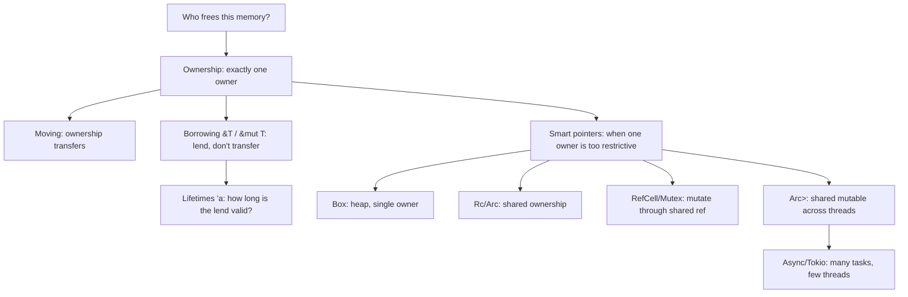
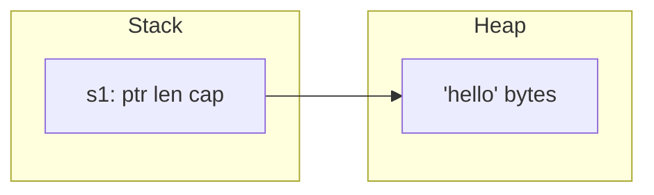

# Rust Fundamentals — Cheatsheet for Easy Stuff, Teaching Journey for Hard Stuff

## Why This Exists

**Problem.** Rust's hardest ideas — ownership, lifetimes, `dyn` trait objects, `Arc<Mutex<T>>`, `Fn`/`FnMut`/`FnOnce`, async — are usually taught syntax-first ("here's how to write `<'a>`"). That memorises spelling, not understanding. Conversely, the simple stuff (`if`, `let`, `for`, basic structs) doesn't need a teaching journey — you just need a quick lookup.

**This note splits the difference.** Section 0 is a compact cheatsheet for the easy parts. Sections 1–12 take the hard parts and start with the *bug* each one prevents, so the syntax shows up as the natural fix.

**Key insight.** Rust has one obsession: **at any moment, exactly one place is responsible for each piece of data.** Every confusing rule (move, `&mut` exclusivity, lifetimes, `Send`/`Sync`, `Arc<Mutex<>>`, `FnOnce`) is a different surface of that same obsession.

**Reach for this when:**
- The compiler says "value borrowed here after move", "cannot borrow as mutable", "does not live long enough", "T does not implement Send"
- You see `<'a>`, `'static`, `dyn Trait`, `Box<dyn Fn() + Send + 'static>` and want to read it like English
- You're choosing between `Rc` vs `Arc`, `RefCell` vs `Mutex`, threads vs `tokio::spawn`, `Fn` vs `FnMut` vs `FnOnce`
- You need a mental model for `.await`, `Pin`, and why async is "lazy"
- You forgot the syntax for ranges, tuple destructuring, `match` guards, the `?` operator

**Don't reach for this when:**
- You want a Rust API reference — go to docs.rs
- You need advanced topics like async traits, GATs, pinning internals, or unsafe — out of scope here

---

## Table of Contents

- [Diagrams](#diagrams) — the one-picture mental models
- [§0. Quick Reference (Cheatsheet)](#0-quick-reference-cheatsheet) — Cargo, types, control flow, structs, enums, match, HashMap, iterators (one-pager)
- [§1. Ownership and Moves](#1-ownership-and-moves) — why moves exist
- [§2. Borrowing](#2-borrowing--lending-without-giving-up-ownership) — `&T` / `&mut T` and the one rule
- [§3. Lifetimes](#3-lifetimes--naming-how-long-is-this-borrow-valid) — `<'a>`, `'static`, dangling, cleanup
- [§4. Pattern Matching Beyond Basics](#4-pattern-matching-beyond-basics) — `if let`, guards, `@`, refutable patterns
- [§5. Error Handling](#5-error-handling--option-result-and-the--operator) — `Option`/`Result` symmetry, `?`, alternatives to `.unwrap()`, `thiserror`, `anyhow`, best practices
- [§6. Generics and Traits](#6-generics-and-traits--the-weird-t-syntax) — `<T>`, bounds, derives, `Sized` / `?Sized`
- [§7. Trait Objects (`dyn`)](#7-trait-objects--dyn-trait-static-vs-dynamic-dispatch) — static vs dynamic dispatch, reading `Box<dyn FnOnce() + Send + 'static>`
- [§8. Closures and `Fn` / `FnMut` / `FnOnce`](#8-closures-and-fn--fnmut--fnonce) — what the three traits actually mean
- [§9. Iterators in Depth](#9-iterators-in-depth) — laziness, `iter` / `iter_mut` / `into_iter`, `collect` tricks
- [§10. Smart Pointers](#10-smart-pointers--when-one-owner-isnt-enough) — `Box`, `Rc`, `Arc`, `RefCell`, `Mutex`, `Weak`
- [§11. Threads, `Send`, `Sync`, Channels](#11-threads-send-sync-and-channels) — `move`, `mpsc`, thread pool
- [§12. Async/Await and Tokio](#12-asyncawait-and-tokio) — lazy futures, `tokio::spawn`, `join!`, `select!`
- [Trade-offs](#trade-offs) — what you give up by picking each tool
- [Common Pitfalls](#common-pitfalls) — failure modes with fixes
- [Decision Table](#decision-table) — scenario → recommendation matrix
- [References](#references) — primary sources

---

## Diagrams

### The unifying picture



### Stack vs heap, and what owns what



When `s1` is dropped, the stack frame goes away *and* the heap bytes are freed. That's what "ownership" buys you for free: deterministic cleanup with no garbage collector.

---

## 0. Quick Reference (Cheatsheet)

> *Use this section as a lookup, not a read-through. Skip ahead to §1+ for the teaching content.*

### Cargo

| Command | Purpose |
|---|---|
| `cargo new project` | scaffold |
| `cargo run` | compile + run |
| `cargo check` | typecheck only (fast) |
| `cargo build --release` | optimised binary |
| `cargo test` | run tests |
| `cargo fmt` / `cargo clippy` | format / lint |

`Cargo.toml` has `[package]` (name, version, edition) and `[dependencies]`. External libraries are called **crates**.

### Variables & shadowing

```rust
let x = 5;          // immutable
let mut y = 5;      // mutable
let x = x + 1;      // shadowing — new binding, can change type
let x: i64 = 10;    // explicit type annotation
```

`mut` mutates an existing binding in place. **Shadowing** creates a brand-new binding with the same name — the old one is gone, and the new one can have a different type entirely. Useful for parsing: `let s = "10"; let s: i32 = s.parse().unwrap();`.

### Primitive types

| Category | Types | Notes |
|---|---|---|
| Signed int | `i8`, `i16`, `i32`, `i64`, `i128`, `isize` | `i32` is the inference default |
| Unsigned int | `u8`, `u16`, `u32`, `u64`, `u128`, `usize` | `usize` for indexing/lengths |
| Float | `f32`, `f64` | `f64` is the default |
| Boolean | `bool` | `true` / `false` |
| Character | `char` | 4 bytes, any Unicode scalar; `'a'` not `"a"` |
| Unit | `()` | the "no value" type — what statements yield |

### Tuples and arrays

```rust
let tup: (i32, f64, bool) = (500, 6.4, true);
let (a, b, c) = tup;             // destructure
let first = tup.0;               // dot indexing

let arr: [i32; 5] = [1, 2, 3, 4, 5];
let zeros = [0u8; 25];           // 25 zeros
let slice: &[i32] = &arr[1..3];  // [2, 3]
```

Out-of-bounds index → runtime panic.

### `Vec` (growable array)

```rust
let mut v: Vec<i32> = Vec::new();
v.push(1);                       // append
v.pop();                         // remove last → Option<T>
let len = v.len();
let macro_v = vec![1, 2, 3];     // shorthand
let prefilled = vec![0u8; 100];  // 100 zeros
```

### Strings — `&str` vs `String`

- `&str` — borrowed UTF-8 slice. Literals (`"hi"`) are `&'static str`.
- `String` — heap-allocated, growable, owned.

```rust
let owned = String::from("hi");
let owned = "hi".to_string();
let borrowed: &str = &owned;     // String → &str
let bytes: &[u8] = "hi".as_bytes();
for c in "abc".chars() { ... }   // iterate chars
```

**Always prefer `&str` for read-only string params** — accepts both literals and `&String`.

(You can't return or hold a bare `str` — it's an unsized type. See §6 "Sized, ?Sized, and why you can't return `str`" for why.)

### Control flow

```rust
// if is an expression
let parity = if n % 2 == 0 { "even" } else { "odd" };

// loop with break-value
let result = loop {
    if cond { break 42; }
};

// while
while x < 10 { x += 1; }

// for over a range
for i in 0..5 { ... }     // 0..=4
for i in 0..=5 { ... }    // 0..=5 inclusive

// for over a collection
for item in &v { ... }    // borrows
for item in v { ... }     // consumes (into_iter)
```

### Functions, expressions, statements

```rust
fn add(x: i32, y: i32) -> i32 {
    x + y                  // expression — no semicolon = return value
}
```

> **Statements** end with `;` and produce `()`. **Expressions** don't end with `;` and produce a value.

Adding a `;` to the final line of a function silently changes the return to `()` — a common bug.

### Printing

```rust
println!("hello, {}", name);          // Display
println!("debug: {:?}", v);           // Debug
println!("pretty: {:#?}", v);         // Debug, multiline
println!("hex: {:x}, pad: {:>5}", n, "x");
eprintln!("error: {}", msg);          // stderr
panic!("invariant broken: {:?}", x);  // abort
```

`println!` and friends are **macros** (the `!`); they support compile-time format-string checking.

### Structs

```rust
// Named-field
struct User {
    name: String,
    age: u32,
}

// Tuple struct
struct Point(f64, f64);

// Unit struct
struct Marker;

let u = User { name: "Alice".into(), age: 30 };
let p = Point(1.0, 2.0);
let x = p.0;                        // tuple-struct field access
let User { name, age } = u;         // destructure

impl User {
    fn new(name: String, age: u32) -> Self {  // associated fn (constructor)
        User { name, age }
    }
    fn greet(&self) { println!("hi {}", self.name); }  // &self
    fn birthday(&mut self) { self.age += 1; }          // &mut self
    fn into_name(self) -> String { self.name }         // self (consumes)
}
```

Three forms of `self`:
- `&self` — read-only borrow (analogy: lending the book to read)
- `&mut self` — exclusive borrow (lending to annotate)
- `self` — takes ownership (giving the book away)

### Enums (the basics)

```rust
enum Shape {
    Circle(f64),                          // tuple variant
    Rectangle { width: f64, height: f64 }, // struct variant
    Origin,                               // unit variant
}

enum Direction { N, S, E, W }
```

Memory: tagged union — one discriminant tag plus space for the largest variant.

The two enums you'll use the most:

```rust
enum Option<T> { Some(T), None }
enum Result<T, E> { Ok(T), Err(E) }
```

`Option<T>` replaces null. `Result<T, E>` replaces exceptions. Both covered in depth in §5.

### `match` (basics)

```rust
match x {
    0 => "zero",
    1 | 2 => "one or two",
    3..=9 => "three to nine",
    n if n < 0 => "negative",
    _ => "something else",
}
```

`match` is exhaustive (every case must be handled, often via `_`) and is itself an expression — all arms must yield the same type. **Deeper patterns (guards, `@` binding, `if let`, `while let`) are in §4.**

### `HashMap`

```rust
use std::collections::HashMap;

let mut scores: HashMap<String, i32> = HashMap::new();
scores.insert("Alice".to_string(), 100);

let alice = scores.get("Alice");      // Option<&i32>
let exists = scores.contains_key("Alice");
scores.remove("Alice");

// entry API: get-or-insert in one shot
*scores.entry("Bob".to_string()).or_insert(0) += 1;

for (k, v) in &scores { ... }
```

`entry` does one lookup instead of two. Word-counting idiom: `*map.entry(word).or_insert(0) += 1;`. Insertion **moves** the key — the map owns it after.

### Iterators (cheat list — depth in §9)

```rust
let v = vec![1, 2, 3, 4, 5];

// Three flavours
v.iter()            // &T (borrows)
v.iter_mut()        // &mut T (borrows mutably)
v.into_iter()       // T (consumes)

// Common adapters (lazy — nothing runs until you consume)
.map(|x| x * 2)
.filter(|x| *x > 0)
.take(3) / .skip(2)
.enumerate()        // yields (index, item)
.zip(other)         // pairs
.chain(other)       // concatenate
.flat_map(|x| ...)
.rev()              // reverse iterator

// Common consumers
.collect::<Vec<_>>()
.collect::<HashMap<_,_>>()
.count() / .sum() / .product()
.max() / .min()
.fold(init, |acc, x| ...)
.for_each(|x| ...)
.any(|x| ...) / .all(|x| ...)
.find(|x| ...) / .position(|x| ...)
```

### Modules and visibility

```rust
// In src/lib.rs or src/main.rs
mod foo;            // declare module → src/foo.rs or src/foo/mod.rs
mod bar {           // inline module
    pub fn hi() {}
    pub(crate) fn helper() {}  // visible only within this crate
}

use std::collections::HashMap;
use crate::foo::Bar;
use super::Sibling;
use self::*;
```

`pub` exposes; private by default. `pub(crate)` is visible anywhere in your crate but not to consumers.

### Useful built-ins

```rust
i.wrapping_add(1)          // wrap on overflow (u8 etc.)
i.checked_add(1)           // None on overflow
i.saturating_add(1)        // clamp at MAX
n as u8                    // primitive cast
opt.unwrap() / .expect("msg") / .unwrap_or(default)
opt.map(|x| ...) / .and_then(|x| ...) / .ok_or(err)
res.unwrap() / .expect("msg") / .unwrap_or(default)
res.map(|x| ...) / .map_err(|e| ...)
```

---

## 1. Ownership and Moves

> *TL;DR — every value has exactly one owner; when the owner ends, the value is freed. Assignment **moves** ownership for heap-owning types; for stack-only primitives that implement `Copy`, it copies.*

### The problem

Two languages you already know:

- **C** — you `malloc` and `free` yourself. Fast, but easy to double-free, leak, or read freed memory.
- **Python/Java** — a garbage collector hunts unreachable memory. Safe, but unpredictable pauses.

Rust wants both: deterministic cleanup *and* no GC. The mechanism: **every value has exactly one owning variable. When that variable goes out of scope, the value is freed.**

```rust
fn main() {
    let s = String::from("hello"); // s owns the string
} // s goes out of scope, string is freed automatically
```

### Why moves exist (and surprise you)

```rust
let s1 = String::from("hello");
let s2 = s1;
println!("{}", s1); // ERROR: value borrowed here after move
```

You'd expect this to copy or alias. It does neither. `String` lives on the heap (it has a pointer, length, and capacity). If both `s1` and `s2` "owned" the same heap data, **who frees it?** If both try, you get a double-free.

Rust's answer: ownership *moves* from `s1` to `s2`. After line 2, `s1` is statically gone — the compiler refuses to let you touch it. Only one owner, no ambiguity.

### Why integers don't move

```rust
let x = 5;
let y = x;
println!("{}", x); // fine
```

`i32` lives entirely on the stack — no heap, no cleanup question. So Rust copies the bits. Types like this implement the `Copy` marker trait. **Rule of thumb: stack-only primitives copy; anything that owns heap data moves.**

### When functions consume your data

```rust
fn print_it(s: String) {
    println!("{}", s);
} // s dropped here

fn main() {
    let s = String::from("hello");
    print_it(s);          // ownership moved into the function
    println!("{}", s);    // ERROR: s was moved
}
```

You almost never want functions to permanently consume their args. The fix is borrowing — covered next.

---

## 2. Borrowing — Lending Without Giving Up Ownership

> *TL;DR — `&T` shares, `&mut T` excludes. At any moment, **either many shared borrows OR one exclusive borrow** — never both. The compiler enforces this to eliminate data races and dangling slices.*

### Shared (`&T`) and exclusive (`&mut T`) references

```rust
fn print_it(s: &String) {       // borrow, don't take ownership
    println!("{}", s);
}

fn add_world(s: &mut String) {  // mutable borrow
    s.push_str(" world");
}

fn main() {
    let mut s = String::from("hello");
    print_it(&s);
    add_world(&mut s);
    println!("{}", s); // "hello world"
}
```

### The one rule that drives everything

> **Either many `&T` (readers), or one `&mut T` (writer). Never both at once.**

```rust
let mut s = String::from("hello");
let r1 = &s;          // shared borrow
let r2 = &mut s;      // ERROR: can't borrow as mutable while shared borrow exists
```

**Why.** Simultaneous read+write across threads is a data race; even single-threaded, mutating while another part of code holds a pointer to the inside (e.g. a slice) creates dangling references when the buffer reallocates. By forbidding it at compile time, Rust eliminates a whole bug class.

### Slices are borrows, too

```rust
let s = String::from("hello world");
let hello: &str = &s[0..5];  // points into s's heap buffer
```

A `&str` is a fat pointer (address + length) into someone else's bytes. So:

```rust
let mut s = String::from("hello world");
let word = &s[0..5];   // word borrows from s
s.clear();             // ERROR: can't mutate s while word borrows it
println!("{}", word);
```

If `s.clear()` were allowed, `word` would point at freed memory. In C, this compiles, runs, and crashes randomly. In Rust, it doesn't compile.

### Non-lexical lifetimes (NLL)

A borrow ends as soon as it's *last used*, not at the end of the block. So this works:

```rust
let mut v = vec![1, 2, 3];
let first = &v[0];
println!("{}", first);   // last use of `first`
v.push(4);               // OK — borrow already ended
```

Older Rust would have rejected this. Modern Rust is friendlier than the textbook rules suggest.

---

## 3. Lifetimes — Naming "How Long Is This Borrow Valid?"

> *TL;DR — `<'a>` names a duration the compiler can reason about; it doesn't extend anything. `'static` means "no short-lived references inside" — a structural promise, not a cleanup directive. Cleanup is `Drop`, separately.*

### The problem they solve

```rust
fn main() {
    let r;
    {
        let x = 42;
        r = &x;
    }
    println!("{}", r); // ERROR: x does not live long enough
}
```

`x` died at the inner brace; `r` would be a dangling pointer. In C this is undefined behavior. Rust rejects it.

For *most* code, the compiler figures out lifetimes silently. But when a function returns a reference, it sometimes can't:

```rust
fn longest(x: &str, y: &str) -> &str {
    if x.len() > y.len() { x } else { y }
}
// ERROR: missing lifetime specifier
```

The compiler asks: *the returned reference points into `x` or `y` — which one? How long is the caller allowed to use it?* You must answer.

### The syntax: `<'a>` is just a name

```rust
fn longest<'a>(x: &'a str, y: &'a str) -> &'a str {
    if x.len() > y.len() { x } else { y }
}
```

Read it: "for some lifetime `'a`, both inputs and the output share that lifetime." **The annotation doesn't change how long anything lives** — it names a relationship the compiler can verify.

`<'a>` looks weird because `'a` is a lifetime parameter, like `<T>` is a type parameter. The leading apostrophe just marks it as "a lifetime, not a type."

### Lifetimes in structs

A struct holding references must declare what they borrow from:

```rust
struct Config<'a> {
    name: &'a str,
}
```

Reads as: "a `Config<'a>` cannot outlive the data its `name` borrows from."

### Elision: why you rarely write lifetimes

The compiler applies three rules silently:

1. Each input reference gets its own lifetime.
2. If there's exactly one input lifetime, it's assigned to all outputs.
3. If `&self` or `&mut self` is present, `self`'s lifetime is assigned to all outputs.

That's why this compiles with no annotations:

```rust
fn first_word(s: &str) -> &str { ... } // rule 2

impl<'a> Config<'a> {
    fn name(&self) -> &str { self.name } // rule 3
}
```

`longest` failed earlier because rule 2 doesn't apply (two inputs) and rule 3 doesn't apply (no `self`).

### `'static` — the longest possible lifetime

`'static` means "valid for the entire program run."

```rust
let s: &'static str = "hello world"; // string literal — baked into the binary
```

Two ways `'static` shows up:

- **As a reference lifetime:** `&'static str` — the data lives forever (literals, leaked allocations, lazy_static).
- **As a bound on a generic:** `T: 'static` means `T` contains no references with shorter lifetimes (it's owned data, or only `'static` references). This is what `tokio::spawn`, `thread::spawn`, and `Box<dyn Trait + 'static>` require — the runtime needs to know your value won't dangle.

### What "dangle" means (and why `'static` exists)

A **dangling reference** is a pointer to memory that has already been freed. The address still looks valid; the data is gone (or reused). Reading from it is undefined behavior — sometimes you get the old data, sometimes garbage, sometimes a segfault. **Every lifetime rule in Rust exists to prevent this.**

In C, this compiles and crashes randomly:

```c
char* greet() {
    char buf[] = "hello";   // on this function's stack frame
    return buf;              // returns pointer to buf
}                            // buf freed HERE — pointer now dangles
```

In Rust, the equivalent is a compile error:

```rust
fn greet() -> &str {
    let s = String::from("hello");
    &s   // ERROR: cannot return reference to local variable `s`
}        // s dropped HERE
```

The compiler reasons: "the returned reference points into `s`; `s` dies at function exit; the reference would outlive its target." **You get a red squiggle instead of a 3am crash.**

**Where `'static` enters.** When you spawn a thread, the closure might run *much later* — possibly after the surrounding function has returned:

```rust
fn make_greeter() {
    let name = String::from("Alice");
    thread::spawn(|| println!("{}", name));   // ERROR: `name` may not live long enough
}   // `name` dropped here — but the thread might still be running
```

If allowed, the thread would print `name` *after* it's been freed — a dangling reference. So `thread::spawn` requires `'static`: "I'll only accept closures whose data won't dangle no matter how long I wait." The fix is `move`, which transfers ownership into the closure:

```rust
fn make_greeter() {
    let name = String::from("Alice");
    thread::spawn(move || println!("{}", name));   // OK — name now lives inside the closure
}
```

> **"Dangle" = a reference that outlives the thing it points to.** Every `<'a>` annotation and every `'static` bound is the compiler asking *"can I prove this reference can't outlive its target?"*

A common trap:

```rust
fn make_string() -> &'static str {
    let s = String::from("hello");
    &s // ERROR: cannot return reference to local variable
}
```

The `String` is freed at function exit; you can't promise `'static` for it. Five fixes, ordered from "almost always right" to "use sparingly":

#### Fix 1: Return an owned `String` (almost always the answer)

```rust
fn make_string() -> String {
    String::from("hello")
}
```

Caller owns it; freed when their binding drops. No `'static` needed.

#### Fix 2: Return a literal (if the content is fixed at compile time)

```rust
fn make_string() -> &'static str {
    "hello"          // baked into the binary's .rodata
}
```

The literal *is* the `'static` reference. No allocation, no `String`.

#### Fix 3: `Box::leak` (only when you genuinely need program-long lifetime)

```rust
fn make_string() -> &'static str {
    let s = String::from("hello");
    Box::leak(s.into_boxed_str())   // intentional, controlled leak
}
```

**Never freed.** Use only when you mean it (globals, lazy singletons). Don't reach for this just to satisfy a `'static` bound — there's almost always a better answer.

#### Fix 4: `LazyLock` for "compute once, keep forever"

```rust
use std::sync::LazyLock;

static GREETING: LazyLock<String> = LazyLock::new(|| {
    String::from("hello")    // computed on first access
});

fn make_string() -> &'static str {
    &GREETING                 // &String → &str via deref coercion
}
```

Lives in a `static` slot, so a reference into it is `'static`. Thread-safe and lazy. Idiomatic since Rust 1.80.

#### Fix 5: Caller-provided buffer (no-allocation hot path)

```rust
fn make_string(out: &mut String) {
    out.clear();
    out.push_str("hello");
}
```

Used when one buffer is reused across many calls.

#### Which one?

| Situation | Fix |
|---|---|
| Built at runtime, caller will use and drop | **#1 — `String`** |
| Content is a compile-time literal | **#2 — literal `"hello"`** |
| Need `'static` for `thread::spawn`/`tokio::spawn` | usually **#1 + `move`** into the closure, not `'static` |
| Program-long lifetime, computed once at startup | **#4 — `LazyLock`** |
| Same, but can't use `LazyLock` (e.g. one-off, key derived at runtime) | **#3 — `Box::leak`** |
| Hot path, reuse one buffer | **#5 — `&mut String` out-param** |

**The mistake to avoid.** Reaching for `Box::leak` to "satisfy" the `'static` requirement on `thread::spawn` is almost always the wrong fix. `thread::spawn` wants `'static` so the captured data *can't dangle* — and `move`-ing an owned `String` into the closure achieves that without leaking anything. The data lives inside the closure; the thread fully owns it. Reach for `Box::leak` only when you genuinely need a `&'static T` *outside* any single closure.

### `'static` is a bound, not a lifetime extender — how does cleanup happen?

A common confusion: "if `'static` makes data live forever, won't Tokio leak memory for every small task?"

**`'static` is not a cleanup instruction.** It's a compile-time bound — a structural promise the borrow checker enforces. Cleanup is a completely separate mechanism: **`Drop`**. They live on different axes:

| Axis | Mechanism | When |
|---|---|---|
| **Validity** (can I read this without UB?) | lifetimes, `'static` | checked at compile time |
| **Cleanup** (when is memory freed?) | `Drop` | runs at owner's end of scope |

`T: 'static` says: "the data inside this value has no references that could go bad — it's owned, or borrows only from `'static` data." It does **not** say "this value will live forever." An owned `String`, a `Vec<u8>`, an `i32` — all satisfy `T: 'static` and all get freed by ordinary ownership the moment their owner drops.

**Drop runs deterministically.** When a value's owner goes out of scope, cleanup runs *now* — no GC sweep, no finalisation queue:

```rust
fn demo() {
    let s = String::from("hello");
    // s goes out of scope here → drop(s) runs → heap freed
}
```

For non-trivial types, you can implement `Drop::drop` to close a file, release a handle, etc. — and it'll fire at the same moment.

**Why Tokio still requires `'static`.** The runtime might run a spawned task *much later*, on *any* worker thread, for *however long it takes*. If the future borrowed `&data` from your `main` function, that borrow could outlive `main`'s frame — dangling. `'static` is the minimum-duration promise that rules this out. It's not a "keep this alive forever" request — it's a "your data structure is safe to run for any duration" assertion.

Once the task finishes, the future drops, and every captured field inside it drops in turn — same ownership rule from §1, applied to async tasks:

```rust
tokio::spawn(async move {
    let s = String::from("hello");   // s owned by this task
    println!("{}", s);
    // task ends → future dropped → s dropped → heap freed
});
```

Spawning a million one-shot tasks doesn't leak. Each task owns its captures; when the task ends, the captures drop.

**Memory genuinely lives forever only when you opt in:**

- `static FOO: ... = ...` — placed in a `static` slot at program start, never freed
- `Box::leak(value)` — intentional heap leak, returns `&'static mut T`
- `Rc`/`Arc` reference cycles — strong counts never reach zero (use `Weak` to break)

If you didn't write one of those, you didn't leak.

---

## 4. Pattern Matching Beyond Basics

> *TL;DR — `if let` / `while let` for single-variant cases, guards for runtime conditions, `@` to test and capture in one go, `let ... else` to early-exit on refutable patterns.*

`match` shows up everywhere in Rust — destructuring `Option`, `Result`, enums, tuples, structs. The basics are in §0; this section covers the parts that surprise people.

### `if let` and `while let`

When you only care about *one* variant, `match` feels heavy:

```rust
match maybe_user {
    Some(u) => println!("{}", u.name),
    None => {}
}
```

`if let` collapses this:

```rust
if let Some(u) = maybe_user {
    println!("{}", u.name);
}
```

`while let` does the same for loops — keep going while the pattern matches:

```rust
while let Some(top) = stack.pop() {
    println!("{}", top);
}
// stops cleanly when pop() returns None
```

Conveyor-belt mental model: run until a slot comes back empty.

### Match guards

A guard adds an `if` condition to an arm:

```rust
match pair {
    (x, y) if x == y     => "equal",
    (x, y) if x + y == 0 => "sum to zero",
    (x, _) if x > 0      => "positive x",
    _                    => "other",
}
```

Important caveat: **the compiler doesn't consider guards when checking exhaustiveness.** It can't predict runtime values, so you still need a wildcard arm if the patterns alone don't cover the type.

### `@` binding — test *and* capture

When you want to match a range *and* keep the value:

```rust
match n {
    small  @ 1..=5  => println!("{} is small", small),
    medium @ 6..=10 => println!("{} is medium", medium),
    large           => println!("{} is large", large),
}
```

Without `@`, `1..=5 => ...` matches but doesn't give you a name to print. `small @ 1..=5` does both — like checking ID at the door *and* writing the name on a sign-in sheet.

### Destructuring structs and enums

```rust
struct Point { x: i32, y: i32 }
let p = Point { x: 1, y: 2 };

let Point { x, y } = p;                        // pull both fields out
let Point { x: hor, y: vert } = p;             // rename while extracting
let Point { x, .. } = p;                       // ignore the rest

// Inside match
match shape {
    Shape::Circle(r) => ...,
    Shape::Rectangle { width: w, height: h } => ...,
}
```

### Refutable vs irrefutable patterns

- **Irrefutable** (always matches): `(a, b)`, `Point { x, y }`, `_`, `name`. Usable in `let` and `for`.
- **Refutable** (might not match): `Some(x)`, `Ok(v)`, `1..=5`. Must use `match`, `if let`, or `while let`.

This fails:

```rust
let Some(value) = some_option; // ERROR: refutable pattern
```

A `let` is a one-way door — there's no else branch — so the compiler refuses patterns that might fail.

The escape hatch (Rust 2024-style `let ... else`):

```rust
let Some(value) = some_option else {
    return;
};
println!("{}", value);   // value is in scope from here on
```

---

## 5. Error Handling — `Option`, `Result`, and the `?` Operator

> *TL;DR — `panic!` for programmer bugs, `Result` for expected failures. `?` propagates errors and auto-converts via `From`. Libraries use `thiserror` enums; apps use `anyhow` with `.context()`. Log once at the boundary.*

### Two failure modes, two types

The author's mental model:

- **`panic!` is for programmer bugs** — invariants you believe hold. Out-of-bounds index, division by zero, "this should never happen." Examples: `array[i]` panicking on bad `i`, `.unwrap()` on a `None` you swore was `Some`.
- **`Result` is for expected failures** — bad input, missing files, network timeouts, parse errors. A web server shouldn't die because one request was malformed.

```rust
enum Option<T> { Some(T), None }
enum Result<T, E> { Ok(T), Err(E) }
```

`Option` is for "value or absence." `Result` is for "value or this specific error."

### Manual matching (verbose)

```rust
fn parse_age(s: &str) -> Result<u32, String> {
    match s.parse::<u32>() {
        Ok(n) => Ok(n),
        Err(_) => Err(format!("can't parse '{}'", s)),
    }
}
```

This works but stacks up fast. The `?` operator collapses it.

### The `?` operator

```rust
fn read_user(path: &str) -> Result<User, MyError> {
    let s = std::fs::read_to_string(path)?;       // io::Error if fails
    let user: User = serde_json::from_str(&s)?;   // serde error if fails
    Ok(user)
}
```

`?` desugars to:

```rust
match expr {
    Ok(v) => v,
    Err(e) => return Err(e.into()),  // ← note .into()
}
```

Rules:
- The enclosing function must return `Result` (or `Option` if you're using `?` on an `Option`).
- The error type bubbles up — but the `.into()` call lets `?` automatically convert one error type to another **if a `From` impl exists**.

### `From` makes errors compose

If `MyError: From<io::Error>` and `MyError: From<serde_json::Error>`, the example above just works — `?` converts both. You don't write the conversion at every call site, only the `From` impl once.

### Custom error enums (with `thiserror`)

Hand-rolling error types is boilerplate-heavy. The `thiserror` crate generates `Display`, `Error`, and `From` impls from attributes:

```rust
#[derive(Debug, thiserror::Error)]
enum ConfigError {
    #[error("io error: {0}")]
    Io(#[from] std::io::Error),                   // auto-impl From<io::Error>

    #[error("parse error at line {line}: {msg}")]
    Parse { line: usize, msg: String },

    #[error("missing required field: {0}")]
    Missing(String),
}
```

Now `?` on any `io::Error`-returning call auto-converts to `ConfigError::Io`.

### `thiserror` vs `anyhow`

- **`thiserror`** — for *library* code. Define a precise error enum so callers can `match` on variants.
- **`anyhow`** — for *application* code. Use `anyhow::Result<T>` and `.context("doing X")` for human-readable error chains. Don't expose `anyhow::Error` from a library — callers can't programmatically distinguish causes.

### `Option` and `Result` are symmetric

The two types deliberately mirror each other. Same vocabulary, same `?` operator. Most methods exist on both:

| Method | `Option<T>` | `Result<T, E>` | Notes |
|---|---|---|---|
| `unwrap` / `expect` | ✅ | ✅ | panic on absence/error |
| `unwrap_or(d)` / `unwrap_or_else(\|...\| ...)` / `unwrap_or_default()` | ✅ | ✅ | supply a default |
| `map(\|t\| ...)` | ✅ | ✅ | transform the success side |
| `and_then(\|t\| ...)` | ✅ | ✅ | flat-map; chain ops that themselves return `Option`/`Result` |
| `is_some` / `is_none` | ✅ | as `is_ok` / `is_err` | predicate checks |
| `as_ref` / `as_mut` | ✅ | ✅ | borrow the inside without consuming |
| `?` operator | ✅ | ✅ | propagates `None`/`Err` from a matching-return function |

Diverging: `Result` has `map_err`, `unwrap_err`, `expect_err`, `err()`, `ok()`; `Option` has `ok_or`, `ok_or_else`, `take`, `replace`, `filter`.

**Bridging.** The two everyday converters:

```rust
let id   = headers.get("X-User-Id").ok_or(MyError::Missing)?;   // Option → Result
let port = "8080".parse::<u16>().ok();                          // Result → Option (drops the error)
```

Mental model: **`Result<T, E>` is `Option<T>` with a reason for the absence.** Anything `Option` can do, `Result` can do — plus carry the error.

### Collecting many errors

If you want all errors at once (a config validator, say) instead of stopping at the first, return `Result<(), Vec<MyError>>` and accumulate. `?` is biased toward fail-fast — sometimes that's wrong.

### Alternatives to `.unwrap()` — what to use instead

`.unwrap()` works but has two problems: it discards *why* the invariant should hold, and it conflates "this shouldn't happen" with "I don't want to think about it." Pick a replacement based on what you actually meant.

#### Taxonomy

| What you really meant | Use this instead |
|---|---|
| "This **can't** be `None`/`Err`; if it is, my program is buggy" | `.expect("invariant: …")` |
| "If it's missing, give me a default" | `.unwrap_or(d)` / `.unwrap_or_else(\|\| …)` / `.unwrap_or_default()` |
| "If it fails, give up this function" | `?` |
| "If it's missing, return/break early" | `let Some(x) = opt else { return; }` |
| "Do X if present, Y if absent" | `match` / `if let` |
| "Transform if present" | `.map()` / `.and_then()` |
| "Turn `Option` into `Result` so I can `?`" | `.ok_or(err)` / `.ok_or_else(\|\| err)` |

#### 1. `.expect("...")` — assertions with documentation

Both `unwrap` and `expect` panic on `None`/`Err`. The difference is the panic message — `expect` lets you record *why* you believed the invariant held:

```rust
let port: u16 = env::var("PORT")
    .expect("PORT env var must be set (checked at startup)")
    .parse()
    .expect("PORT env var should be a valid u16");
```

If the panic fires, the message tells future-you exactly which assumption broke. **Rule of thumb: when you really *do* want to crash, use `.expect("...")` not `.unwrap()`. The message is a comment that has to be there.**

#### 2. Defaults — the `unwrap_or` family

```rust
let name = maybe_name.unwrap_or(String::from("anonymous"));   // eager
let name = maybe_name.unwrap_or_else(|| compute_default());   // lazy — runs only on None
let count = maybe_count.unwrap_or_default();                   // T::default()
```

`unwrap_or` evaluates its argument eagerly. `unwrap_or_else` takes a closure, so the default only runs when needed — important when constructing it is expensive (allocation, DB query).

#### 3. `?` — propagate the failure

If failure is plausible, push the decision upward:

```rust
fn load(path: &str) -> Result<Config, MyError> {
    let s = std::fs::read_to_string(path)?;
    let cfg = toml::from_str(&s)?;
    Ok(cfg)
}
```

The caller decides what to do — retry, log, return a 500. Your function just declares "I might fail with `MyError`."

#### 4. `let ... else` — early-exit on absence

When `None` means "skip this path," this is cleaner than `unwrap` + branching:

```rust
fn process(req: &Request) -> Result<(), MyError> {
    let Some(user_id) = req.headers.get("X-User-Id") else {
        return Err(MyError::Unauthenticated);
    };
    do_work(user_id)
}
```

The `else` branch must diverge (`return`, `break`, `continue`, `panic!`, `loop`). Keeps the happy path flat.

#### 5. `match` / `if let` — handle both cases

When you genuinely need different behaviour for each branch:

```rust
match cache.get(&key) {
    Some(v) => use_cached(v),
    None => {
        let v = compute();
        cache.insert(key, v.clone());
        use_cached(v);
    }
}
```

Or just one branch:

```rust
if let Some(v) = cache.get(&key) {
    use_cached(v);
}
```

#### 6. `.map()` / `.and_then()` — transform without unwrapping

Stay inside `Option`/`Result` and let the transform run only on the success path:

```rust
// Verbose
let upper = match maybe_name {
    Some(n) => Some(n.to_uppercase()),
    None    => None,
};

// Idiomatic
let upper = maybe_name.map(|n| n.to_uppercase());

// When the transform itself returns Option/Result, use and_then to avoid nesting:
let first_word = maybe_text
    .and_then(|s| s.split_whitespace().next().map(String::from));
```

`map` for plain transforms, `and_then` (flatMap) when the transform itself returns `Option`/`Result`.

#### 7. `.ok_or()` — lift `Option` to `Result` so you can `?`

```rust
fn find(name: &str) -> Result<User, MyError> {
    let row = db.query("…")?;
    let user = row.get("user").ok_or(MyError::NotFound)?;
    Ok(user)
}
```

`.ok_or(err)` evaluates `err` eagerly. `.ok_or_else(|| err)` is lazy — use when constructing the error is non-trivial. `.ok()` does the reverse (`Result<T, E> → Option<T>`, drops the error).

#### 8. Combinator chains for terse pipelines

```rust
fn extract_port(s: &str) -> Option<u16> {
    s.split(':')
        .nth(1)                          // Option<&str>
        .and_then(|p| p.parse().ok())    // Option<u16>
}
```

#### When `.unwrap()` is fine

Three cases where it's idiomatic:

1. **In tests** — if it fails, the test fails. That's what you wanted.
2. **In examples / quick scripts** — crashing is acceptable.
3. **Immediately after a hardcoded input** — `Regex::new(r"\d+").unwrap()` is fine because the regex is constant and CI would catch a typo. But `.expect("hardcoded regex must compile")` is one keystroke better.

In production library / binary code: prefer `expect`, `?`, or a combinator.

#### The mental flow

When you're about to type `.unwrap()`, ask:

```
Is failure possible at runtime?
├── No — it's a programmer-asserted invariant
│      → .expect("why this should hold")
└── Yes
    ├── I have a sensible default
    │      → .unwrap_or / .unwrap_or_else / .unwrap_or_default
    ├── I want to give up this function
    │      → ?
    ├── I want to early-return only on None
    │      → let Some(x) = opt else { return; }
    ├── I want to handle both branches differently
    │      → match / if let
    └── I want to keep transforming
           → .map / .and_then / .ok_or / .ok / .filter
```

### Best practices

The `.unwrap()` discussion above covers when *not* to crash. These cover everything else:

**1. Don't `unwrap`/`expect` on user-controlled input.** That's a denial-of-service. Reserve panics for *your* invariants — wrong input is an `Err`, not a panic.

**2. Add context as you bubble up.** A bare `Err(io::Error)` tells you "file not found" but not *which* file. With `anyhow`:

```rust
use anyhow::Context;

fn load_config(path: &Path) -> anyhow::Result<Config> {
    let s = std::fs::read_to_string(path)
        .with_context(|| format!("reading config at {}", path.display()))?;
    let cfg: Config = toml::from_str(&s)
        .with_context(|| format!("parsing config at {}", path.display()))?;
    Ok(cfg)
}
```

When this fails, the user sees a chain: `parsing config at /etc/app.toml` → `caused by: expected value at line 7`. With `thiserror`, you do the same by including the path in your error variant: `Parse { path: PathBuf, source: toml::de::Error }`.

**3. Pick the right error tool for the call site.**

| Kind | Tool | Why |
|---|---|---|
| Library that callers will `match` on | `thiserror` enum | Variants are the public API |
| Application (binary, script, internal tool) | `anyhow::Result` | Just chain context, easy to use |
| Quick prototype / test | `Box<dyn Error>` | No deps; works with `?` |

Never expose `anyhow::Error` from a library — callers can't programmatically distinguish causes.

**4. Use `#[from]` for natural conversions, custom variants for context-rich ones.** `#[from]` is great when the source error already carries all the context you need (`io::Error`). When you want to attach extra info (which file, which line, which user), make it a struct variant:

```rust
#[derive(thiserror::Error, Debug)]
enum AppError {
    #[error(transparent)]                              // bare wrap
    Io(#[from] std::io::Error),

    #[error("loading user {user_id}")]                 // adds context
    LoadUser { user_id: u64, source: sqlx::Error },
}
```

`#[error(transparent)]` defers to the inner error's `Display` — useful for "I just want to wrap this."

**5. Make invalid states unrepresentable so you don't need an error.** The best error handling is no error. If a function "can't fail because the inputs were already validated," reflect that in types:

```rust
// Instead of: fn send(email: &str) -> Result<(), InvalidEmail>
// Validate once at the boundary, then pass a typed state:
struct ValidEmail(String);
impl ValidEmail {
    fn parse(s: &str) -> Result<Self, InvalidEmail> { ... }
}
fn send(email: &ValidEmail) { /* infallible */ }
```

This is the "parse, don't validate" idiom. It pushes failures to the boundary and shrinks the rest of the codebase's error surface.

**6. Don't `panic!` to skip work in async / threaded code.** A panicked task or thread is *captured* (you'll get an `Err` from `join`/`await`), but the rest of the runtime keeps going. That's not "graceful failure" — it's a silent bug waiting to surprise you. Return errors instead.

**7. Turn on backtraces in development.** Set `RUST_BACKTRACE=1` (or `RUST_BACKTRACE=full`) before running. With `anyhow`, the backtrace is captured automatically and prints with the error chain. Don't add manual backtraces to error types unless profiling shows they matter — they're not free.

**8. Log at the boundary, not at every layer.** Logging an error at every `?` site clutters output and obscures the real chain. Let `?` propagate; log once at the place that decides what to do (request handler, top-level CLI, retry loop).

---

## 6. Generics and Traits — The "Weird `<T>` Syntax"

> *TL;DR — `<T>` is a type placeholder filled at compile time (monomorphization, zero runtime cost). Traits are contracts; use `T: Trait` bounds to call methods on a generic. `Sized` is implicit; opt out with `?Sized` to accept DSTs through a reference.*

### Why generics exist

You write the same function twice for `i32` and `f64`. Generics let you write it once:

```rust
fn identity<T>(value: T) -> T { value }
```

Read `<T>` as: "for any type T..." When you call `identity(5)`, the compiler creates a specialised version with `T = i32`. This is **monomorphization** — zero runtime cost; the binary contains one copy per concrete type used.

`<T>` looks weird at first because Rust crams the parameter list into the signature: `fn name<TYPE_PARAMS>(VALUE_PARAMS) -> RETURN`. Once you see it as "the type parameters come before the value parameters," it stops feeling alien.

### The limit of unbounded generics

```rust
fn max<T>(a: T, b: T) -> T {
    if a > b { a } else { b } // ERROR: T might not support >
}
```

`T` could be anything — a struct with no ordering, a file handle. The compiler refuses to assume `>` works. You need a **bound** that says "T must support comparison":

```rust
fn max<T: PartialOrd>(a: T, b: T) -> T {
    if a > b { a } else { b }
}
```

`T: PartialOrd` reads "T must implement `PartialOrd`" (the trait that provides `<`, `>`, `<=`, `>=`).

### Traits = behavioural contracts

```rust
trait Card {
    fn value(&self) -> u8;
    fn display(&self) -> String;

    // default method — implementors get this free
    fn is_face(&self) -> bool { self.value() >= 10 }
}

struct PokerCard { rank: Rank, suit: Suit }

impl Card for PokerCard {
    fn value(&self) -> u8 { /* ... */ }
    fn display(&self) -> String { /* ... */ }
}
```

A trait is a promise: "any type implementing me has `value()` and `display()`." Compare to interfaces in Java/Go.

### Combining bounds: `+` and `where`

```rust
fn process<T: Card + Clone + Debug>(card: T) { /* ... */ }

// equivalent, easier to read with many bounds
fn process<T>(card: T) where T: Card + Clone + Debug { /* ... */ }
```

`+` means "all of these." Use `where` once you have more than two bounds — it keeps the signature line readable.

### Derive macros — auto-implementations

```rust
#[derive(Debug, Clone, Copy, PartialEq)]
struct PokerCard { rank: Rank, suit: Suit }
```

| Derive | What it gives you |
|---|---|
| `Debug` | `{:?}` formatting |
| `Clone` | `.clone()` |
| `Copy` | bitwise copy on assignment instead of move |
| `PartialEq` / `Eq` | `==`, `!=` |
| `PartialOrd` / `Ord` | `<`, `>`, sorting |
| `Hash` | usable as a `HashMap` key |
| `Default` | `Default::default()` |

You can't derive everything — `Display` requires you to choose formatting, custom traits need real logic.

### The orphan rule

> You can implement trait `T` for type `S` only if `T` or `S` is from your crate.

This stops two crates from defining conflicting `impl Display for Vec<u8>` blocks. Workaround: the **newtype pattern** — wrap the foreign type in your own struct:

```rust
struct ByteVec(Vec<u8>);
impl std::fmt::Display for ByteVec { /* now allowed */ }
```

### Generic structs + bounds-on-impl

```rust
struct Deck<T> { cards: Vec<T> }

impl<T: Card + Clone> Deck<T> {
    fn shuffle(&mut self) { /* requires T: Clone */ }
}

// constructor only for one specific instantiation
impl Deck<PokerCard> {
    fn new() -> Self { /* build 52 cards */ }
}
```

The pattern: keep the engine generic (`impl<T> Deck<T>`), but place type-specific construction on a non-generic block (`impl Deck<PokerCard>`). `Deck::<UnoCard>::new()` then won't compile — exactly what you want.

### `Sized`, `?Sized`, and why you can't return `str`

Every value the compiler handles "directly" — function arguments, return values, locals, array elements — must have a size known at compile time. That's how it lays out stack frames and chooses calling conventions.

**The implicit `Sized` bound.** Every generic has one for free:

```rust
fn id<T>(x: T) -> T { x }
// is actually:
fn id<T: Sized>(x: T) -> T { x }
```

So `T` can be `i32`, `String`, `Vec<u8>` — but not `str`, `[u8]`, or `dyn Trait`. Those are **dynamically sized types (DSTs)** — their length isn't known until runtime.

**Why `fn bad() -> str { ... }` doesn't compile.** `str` is a sequence of UTF-8 bytes of unknown length. There's no "size of a `str`" the compiler can use to allocate the return slot. The fix is to put it behind a pointer (which is itself sized):

| Type | What it is | Size on the stack |
|---|---|---|
| `&str` | fat pointer: address + length | 16 bytes (on 64-bit) |
| `&'static str` | same, with `'static` lifetime | 16 bytes |
| `Box<str>` | heap-owned, fat pointer | 16 bytes |
| `String` | heap-owned: ptr + len + capacity | 24 bytes |

Same shape for slices (`&[T]`, `Vec<T>`, `Box<[T]>` — never bare `[T]`) and trait objects (`&dyn Trait`, `Box<dyn Trait>` — never bare `dyn Trait`).

**Opting out with `?Sized` ("maybe sized").** When a generic should accept DSTs too, relax the bound — but then you can only use the type *behind a pointer*:

```rust
fn print<T: ?Sized + std::fmt::Display>(x: &T) {  // &T, not T
    println!("{}", x);
}

print("hello");   // T = str
print(&42);       // T = i32
```

This is exactly how `&str` and `&dyn Trait` work under the hood — they're `&T` where `T: ?Sized`.

**Where `Sized` is required vs optional:**

| Position | Must be `Sized`? |
|---|---|
| Function parameter (by value) | yes |
| Function return (by value) | yes |
| Local variable | yes |
| Struct field (any but the last) | yes |
| Last field of a struct | no — DSTs allowed |
| Array element `[T; N]` | yes |
| Behind a pointer (`&T`, `Box<T>`, `Rc<T>`, ...) | no |

The "last field can be unsized" rule is how `Box<str>` works internally — the box knows the length, the bytes follow.

**Mental model.** The compiler builds stack frames at compile time. It needs every directly-held value's size in advance. Pointers sidestep this by being a fixed size themselves (one or two words); the variable-length data they point to lives somewhere else.

> **`str` is the data; `&str` / `String` / `Box<str>` are the handles.** You move handles around because they're a known size.

---

## 7. Trait Objects — `dyn Trait`, Static vs Dynamic Dispatch

> *TL;DR — `<T: Trait>` is static dispatch (fast, type-known); `dyn Trait` is dynamic dispatch (fat pointer + vtable). Use `dyn` to store mixed concrete types in one collection. After `+` you can stack auto traits (`Send`, `Sync`) and lifetimes (`'static`) — but only one method-bearing trait.*

### Two ways to use a trait

When a function "takes any type that implements `Card`", Rust offers two paths:

**Static dispatch (generics):**
```rust
fn play<T: Card>(card: T) { card.display(); }
```
Compiler generates a copy of `play` per concrete type. Fast (inlined calls), bigger binary.

**Dynamic dispatch (trait objects):**
```rust
fn play(card: &dyn Card) { card.display(); }
fn play_boxed(card: Box<dyn Card>) { card.display(); }
```
One copy of `play`. The `&dyn Card` is a **fat pointer**: data pointer + vtable pointer. Calling `card.display()` looks up the function in the vtable at runtime. Slightly slower, smaller binary, can hold *different* concrete types in the same collection.

### When to pick which

| You want... | Use |
|---|---|
| Max performance, type known at compile time | `<T: Trait>` (static) |
| `Vec<Card>` of mixed concrete types | `Vec<Box<dyn Card>>` (dynamic) |
| Plugin/strategy pattern, type chosen at runtime | `Box<dyn Card>` |

You can't write `Vec<T: Card>` — `T` would have to be one specific type for the whole vector. Trait objects are the escape hatch.

### Reading `Box<dyn FnOnce() + Send + 'static>` slowly

This shows up all over async/threading code. Decode from the inside out:

- `FnOnce` — a **trait** (not a function), implemented by closures callable exactly once. The `()` is its parameter list (sugar for `<()>`), and a missing `-> T` means it returns `()`. So `FnOnce()` = "callable once, no args, returns unit." (Full trait family in §8.)
- `+ Send` — *also* `Send`-safe (transferable between threads).
- `+ 'static` — contains no short-lived references (no dangling possible).
- `dyn FnOnce() + Send + 'static` — a trait object combining those constraints into one virtual type.
- `Box<...>` — heap-allocated, single owner, type-erased.

Plain English: **"a heap-stored, thread-transferable, dangling-free closure that can be called once."** That's the workhorse type for thread pools: worker receives the job → calls it once → may consume its captures → done.

**`dyn` applies only to the trait part.** `Send` and `'static` are additional bounds on the *same* trait object, not separate `dyn`s. Parenthesise it mentally:

```
Box< dyn (FnOnce()) + Send + 'static >
       └────┬────┘   └──┬──┘   └──┬──┘
       the trait     extra      lifetime
       being         bound      bound
       dyn'd
```

The rule: **a trait object can contain only one method-bearing trait.** Everything after the `+` must be either:

- an **auto trait** — `Send`, `Sync`, `Unpin` (no methods, just markers)
- a **lifetime bound** — `'static`, `'a`

That's why `dyn FnOnce() + Read` is illegal — two method-bearing traits at once; Rust can't lay out a single vtable for both. Workaround: define a combined trait and `dyn` that:

```rust
trait MyJob: FnOnce() + Read {}     // new trait requiring both
// then: Box<dyn MyJob>
```

---

## 8. Closures and `Fn` / `FnMut` / `FnOnce`

> *TL;DR — closures package code + captured state. `Fn` reads captures, `FnMut` mutates them, `FnOnce` consumes them. Pick the **loosest** bound that still fits — it accepts more callers. `move` shifts where captures live; the trait is determined by what the body does.*

### Syntax

A closure is an anonymous function that can capture variables from its environment. `|...|` is the param list, just like `(...)` for functions.

```rust
let add_one = |n| n + 1;                        // inferred types
let add     = |a: i32, b: i32| -> i32 { a + b }; // explicit param + return
let greet   = || println!("hi");                // no params

// single expression: braces optional
// multi-statement: braces required
```

Each closure has its own anonymous type you can't name directly. To annotate the *binding's* type, go through a trait — `let add: fn(i32, i32) -> i32 = |a, b| a + b;` (function-pointer type, only works for closures with no captures), or `let add: Box<dyn Fn(i32, i32) -> i32> = Box::new(|a, b| a + b);`.

### The three closure traits — what they actually mean

This is the part that confuses people. `Fn`, `FnMut`, `FnOnce` describe **how the closure uses its captures**, mirroring the borrow rules:

| Trait | Capture mode | Borrow analogue | Callable how often |
|---|---|---|---|
| `Fn` | shared ref (`&T`) | `&self` | many times |
| `FnMut` | exclusive ref (`&mut T`) | `&mut self` | many times (mutates) |
| `FnOnce` | by value (`T`) | `self` | exactly once |

Three mini-examples that show each:

```rust
let s = String::from("hello");
let print_it = || println!("{}", s);    // captures &s — Fn
print_it(); print_it();                 // OK, callable many times

let mut s = String::from("hello");
let mut push_world = || s.push_str(" world");  // captures &mut s — FnMut
push_world();                            // mutates s

let s = String::from("hello");
let consume = move || drop(s);           // captures s by value — FnOnce
consume();
// consume();  // ERROR: s was already dropped on first call
```

Rust **picks the least restrictive mode automatically** based on the body. You almost never annotate the trait — but you'll see it in *function signatures* that take a closure.

### Hierarchy: `Fn ⊆ FnMut ⊆ FnOnce`

Anything that's `Fn` is also `FnMut` (a function that only reads can also "mutate" by doing nothing). Anything `FnMut` is also `FnOnce`. So:

- A function param `F: Fn(...)` is the **most restrictive** — accepts the fewest closures.
- `F: FnOnce(...)` is the **most permissive** — accepts the most.

**Pick the loosest bound that fits what you'll do with the closure.** If you only call it once, demand `FnOnce`. If you call it repeatedly without mutating, demand `Fn`.

### `move` — force ownership transfer

By default, closures borrow their captures. The `move` keyword forces them to take ownership instead:

```rust
let s = String::from("hello");
let closure = move || println!("{}", s);
// println!("{}", s);   // ERROR: s was moved into closure
```

You need `move` whenever the closure outlives the surrounding scope:

- Spawning a thread: `thread::spawn(move || ...)`
- Spawning a tokio task: `tokio::spawn(async move { ... })`
- Returning a closure from a function

`move` doesn't change which trait the closure implements — that's still determined by *what the body does* with the captures. `move || println!("{}", s)` still implements `Fn` because the body only reads `s`. `move` just shifts where `s` lives.

### Closures as parameters

Three ways:

```rust
// Generic + bound — static dispatch, fastest
fn run<F: Fn(i32) -> i32>(f: F) -> i32 { f(5) }

// impl Trait — same as above, less verbose
fn run(f: impl Fn(i32) -> i32) -> i32 { f(5) }

// Trait object — dynamic dispatch, can store mixed closures
fn run(f: &dyn Fn(i32) -> i32) -> i32 { f(5) }
fn run(f: Box<dyn Fn(i32) -> i32>) -> i32 { f(5) }
```

### Returning a closure

You can't return a generic closure because each closure has a unique anonymous type. Two options:

```rust
// impl Trait — single concrete type, opaque to caller
fn make_adder(x: i32) -> impl Fn(i32) -> i32 {
    move |n| n + x
}

// Boxed trait object — needed if you might return different closures
fn pick_op(add: bool) -> Box<dyn Fn(i32, i32) -> i32> {
    if add { Box::new(|a, b| a + b) }
    else   { Box::new(|a, b| a - b) }
}
```

### Storing many closures together

Same problem as collections of trait objects — different closures have different anonymous types:

```rust
let c1 = |x: &str| x.len() > 80;
let c2 = |x: &str| x.contains('\t');
let rules: Vec<???> = vec![c1, c2];   // ??? — they're different types

// Fix: box them as trait objects
let rules: Vec<Box<dyn Fn(&str) -> bool>> = vec![Box::new(c1), Box::new(c2)];
```

### Mental model

> **A closure packages behaviour + captured state into one value.** The `Fn`/`FnMut`/`FnOnce` trait it implements is determined by how its body uses the captures, mirroring `&self`/`&mut self`/`self` on regular methods.

---

## 9. Iterators in Depth

> *TL;DR — an iterator is anything with `.next() -> Option<Item>`. Adapters are **lazy** — nothing runs until a consumer (`collect`, `for`, `sum`, …) pulls. `collect` is polymorphic; the turbofish (`::<Vec<_>>()`) picks the container.*

The cheatsheet in §0 lists the adapters. The teaching parts are below.

### What an iterator actually is

```rust
trait Iterator {
    type Item;
    fn next(&mut self) -> Option<Self::Item>;
}
```

That's it. An iterator is anything with a `next` method that returns `Some(item)` repeatedly, then `None` forever. Pez dispenser.

`for item in collection` desugars roughly to:

```rust
let mut iter = collection.into_iter();
while let Some(item) = iter.next() {
    // body
}
```

### Three forms — and why each exists

```rust
v.iter()        // yields &T            — collection unchanged, you read
v.iter_mut()    // yields &mut T        — you mutate in place
v.into_iter()   // yields T (consumes)  — you take ownership, collection gone
```

Library-book analogy: `iter()` reads, `iter_mut()` annotates in pencil, `into_iter()` buys the books — afterward the shelf is empty.

`for x in &v` is sugar for `v.iter()`. `for x in &mut v` is `v.iter_mut()`. `for x in v` is `v.into_iter()`.

### Laziness

This does **nothing**:

```rust
v.iter().map(|x| { println!("processing {}", x); x * 2 });
```

No `processing` lines print. Adapters build a description; values flow through only when something *consumes* the chain — `collect()`, `count()`, `sum()`, `for_each()`, a `for` loop, `.next()`.

Why lazy? Composability and zero-cost abstraction. A chain of `.map().filter().take(3)` doesn't allocate intermediate vectors — it processes one element at a time, end-to-end, and stops as soon as `take` is satisfied.

### `collect` and the turbofish

`collect` is the most flexible consumer — it can build many different collection types:

```rust
let v: Vec<i32> = (1..=5).map(|x| x * x).collect();
let s: HashSet<i32> = v.iter().copied().collect();
let m: HashMap<&str, i32> = vec![("a", 1), ("b", 2)].into_iter().collect();
```

The compiler usually can't infer the target collection, so you give it via:
- annotation on the `let` binding: `let v: Vec<_> = ...`
- turbofish on the call: `.collect::<Vec<_>>()`

`_` lets the compiler infer the element type while you fix the container.

### Common trap: `collect::<Result<Vec<T>, E>>()`

If your iterator yields `Result<T, E>`, you can collect into `Result<Vec<T>, E>` — the first `Err` short-circuits the whole chain:

```rust
let parsed: Result<Vec<i32>, _> = strings.iter().map(|s| s.parse::<i32>()).collect();
```

Same trick works for `Option<Vec<T>>`. This is one of those moments where Rust feels magical.

---

## 10. Smart Pointers — When "One Owner" Isn't Enough

> *TL;DR — `Box` (heap, single owner), `Rc`/`Arc` (shared ownership, single-thread / multi-thread), `RefCell`/`Mutex` (mutate through shared ref, runtime checking, single-thread / multi-thread), `Weak` (non-owning back-edge, breaks cycles).*

A smart pointer is a struct that wraps data and adds management. `String` and `Vec<T>` are technically smart pointers. The library types you'll meet:

### `Box<T>` — heap, single owner

```rust
let x = Box::new(42); // 42 lives on the heap; Box is the owner
```

**Use for:**
- Recursive types where the size isn't known at compile time (`enum List { Cons(i32, Box<List>), Nil }`)
- Trait objects (`Box<dyn Trait>`)
- Moving large values cheaply (move the Box, not the bytes)

Mental model: a numbered locker. The key (Box on the stack) is small; the contents live in the locker (heap).

### `Rc<T>` — multiple owners (single-threaded)

```rust
use std::rc::Rc;
let a = Rc::new(42);
let b = Rc::clone(&a); // not a deep copy — bumps a counter
let c = Rc::clone(&a);
// data freed when last Rc drops
```

**Use for:** graph/tree structures where multiple parts of code logically own the same node.

**Cost:** non-atomic counter — fast but **not thread-safe**.

### `RefCell<T>` — mutate through a shared reference

The compile-time borrow checker is sometimes too strict. `RefCell` moves the same checks to **runtime**:

```rust
use std::cell::RefCell;

struct Counter { count: RefCell<u32> }

impl Counter {
    fn increment(&self) {                  // note: &self, not &mut self
        *self.count.borrow_mut() += 1;     // mutates through a shared ref
    }
}
```

`borrow()` returns `Ref<T>` (shared); `borrow_mut()` returns `RefMut<T>` (exclusive). Break the rule (e.g. two `borrow_mut()` at once) and you get a **runtime panic**, not a compile error.

This is **interior mutability** — the binding looks immutable from outside, but you can mutate the contents.

### `Rc<RefCell<T>>` — shared mutable state, single-threaded

The canonical idiom for a tree where parents need to mutate children, or a graph where nodes get edited from multiple owners:

```rust
let shared = Rc::new(RefCell::new(42));
let a = Rc::clone(&shared);
let b = Rc::clone(&shared);
*a.borrow_mut() += 1;
println!("{}", b.borrow()); // 43
```

Read inside out: data → runtime borrow checking → multi-owner heap allocation.

### `Weak<T>` — non-owning reference (breaks cycles)

`Rc` leaks memory if you make a cycle:

```rust
a.borrow_mut().next = Some(Rc::clone(&b));
b.borrow_mut().next = Some(Rc::clone(&a)); // strong count never hits 0 → leak
```

`Weak<T>` references without bumping the strong count:

```rust
let strong = Rc::new(42);
let weak = Rc::downgrade(&strong);
drop(strong);
match weak.upgrade() {
    Some(rc) => println!("alive: {}", rc),
    None => println!("dropped"),
}
```

| Pointer | Owns? | Prevents drop? |
|---|---|---|
| `Rc<T>` | yes (shared) | yes |
| `Weak<T>` | no | no |

Pattern: in a tree, parents own children with `Rc`, children point back to parents with `Weak`.

### `Arc<T>` — Atomic Rc, for threads

`Rc` uses non-atomic counting and **does not implement `Send`** — you literally can't compile code that hands an `Rc` to another thread. `Arc` is the same API with atomic operations.

```rust
use std::sync::Arc;
use std::thread;
let data = Arc::new(vec![1, 2, 3]);
for _ in 0..3 {
    let d = Arc::clone(&data);
    thread::spawn(move || println!("{:?}", d));
}
```

Use `Arc` whenever multiple threads need shared ownership. Pay a tiny atomic-op cost for thread safety.

### `Mutex<T>` — exclusive access across threads

`Arc` alone is read-only sharing. For mutation, wrap the data in a `Mutex`:

```rust
use std::sync::Mutex;
let m = Mutex::new(0);
{
    let mut guard = m.lock().unwrap(); // blocks until acquired
    *guard += 1;
} // guard dropped here → lock released
```

`lock()` returns `Result<MutexGuard, _>` — `Err` means another thread panicked while holding the lock ("poisoning"). The guard derefs to `&mut T`; releasing happens automatically when it's dropped.

### `Arc<Mutex<T>>` — shared mutable state across threads

The thread-safe analogue of `Rc<RefCell<T>>`:

```rust
use std::sync::{Arc, Mutex};
use std::thread;

let counter = Arc::new(Mutex::new(0));
let mut handles = vec![];
for _ in 0..5 {
    let c = Arc::clone(&counter);
    handles.push(thread::spawn(move || {
        *c.lock().unwrap() += 1;
    }));
}
for h in handles { h.join().unwrap(); }
println!("{}", *counter.lock().unwrap()); // 5
```

### Which smart pointer when?

| Need | Pick |
|---|---|
| Heap-allocate, single owner | `Box<T>` |
| Multiple owners, single thread | `Rc<T>` |
| Mutate through shared ref, single thread | `RefCell<T>` |
| Multiple owners + mutation, single thread | `Rc<RefCell<T>>` |
| Multiple owners, multi-thread | `Arc<T>` |
| Multiple owners + mutation, multi-thread | `Arc<Mutex<T>>` |
| Break a reference cycle | `Weak<T>` |

---

## 11. Threads, `Send`, `Sync`, and Channels

> *TL;DR — `thread::spawn(move || ...)`. `Send` = safe to move to another thread; `Sync` = safe to share `&T` across threads. Communicate with `mpsc` channels rather than shared mutable state when you can.*

### `thread::spawn` and `move`

```rust
use std::thread;
let name = String::from("Alice");
let handle = thread::spawn(move || {     // move = take ownership
    println!("hi {}", name);
});
handle.join().unwrap();
```

Why `move`? The closure outlives the function that created it. If it borrowed `name`, the reference might dangle when the parent function returns. `move` forces ownership transfer into the closure. Anything captured must be `Send` — transferable between threads.

### `Send` and `Sync` — the marker traits

- **`Send`**: it's safe to *move* this type to another thread.
- **`Sync`**: it's safe to *share* a `&T` across threads.

The compiler infers these for you. `Rc` is `!Send` and `!Sync` (non-atomic counting). `Arc<T>` is `Send + Sync` *if T is*. Raw pointers are `!Send`. You almost never write these manually — you just feel their absence when the compiler refuses your code.

### Channels (`mpsc`)

mpsc = multiple producer, single consumer. Threads communicate by sending values, not by sharing state:

```rust
use std::sync::mpsc;
use std::thread;

let (tx, rx) = mpsc::channel();
thread::spawn(move || tx.send(42).unwrap());
let v = rx.recv().unwrap(); // blocks until message arrives
```

`Sender` is `Clone` — many producers, one receiver. `mpsc::sync_channel(n)` gives you a bounded queue (backpressure when full).

### The thread pool pattern (worth knowing by heart)

```rust
type Job = Box<dyn FnOnce() + Send + 'static>;
```

Read it: "a heap-stored, thread-transferable, no-dangling closure callable once." That's exactly what a thread pool needs to ferry work to workers.

```
main thread
   │  tx.send(job)
   ▼
   ┌──── mpsc channel ────┐
   │ Arc<Mutex<Receiver>> │
   └──────────────────────┘
       ▲       ▲       ▲
       │       │       │  workers race for the lock,
   Worker1  Worker2  Worker3   exactly one wins each message
```

Why `Arc<Mutex<Receiver>>`? `Receiver` is `!Sync` — receiving is stateful, only one thread should pop each message. Wrapping it in a mutex serialises receives; `Arc` lets all workers hold a handle.

---

## 12. Async/Await and Tokio

> *TL;DR — async functions are **lazy**: calling one returns a `Future`; nothing runs until something polls it (via `.await`). Tokio is a runtime: reactor + executor. `tokio::spawn` places a task (not a thread). `join!` waits for all, `select!` waits for the first.*

### Mental model: waiter, not chefs

Threads are like a restaurant with one waiter per table — heavy, expensive, OS-scheduled. Each thread carries a multi-MB stack; switching costs a kernel trap.

Async is one waiter handling many tables. While table 1's order is in the kitchen, the waiter takes table 2's order. **Tasks voluntarily yield at `.await` points** — cooperative scheduling, not preemptive.

**Async wins** when programs spend most of their time *waiting* (network, DB, files). For CPU-heavy work, threads are still right.

### Async functions are lazy

```rust
async fn hello() -> String { String::from("hello") }
```

Calling `hello()` does **not** run the body. It returns a `Future` — a value representing computation-not-yet-done. The body only runs when something polls it (`.await`):

```rust
async fn greet() {
    let msg = hello().await; // now the body runs
    println!("{}", msg);
}
```

This is the single most surprising thing about async Rust. **An async function call is like building a recipe; `.await` is cooking.**

### The `Future` trait

```rust
pub trait Future {
    type Output;
    fn poll(self: Pin<&mut Self>, cx: &mut Context<'_>) -> Poll<Self::Output>;
}

// Poll<T> = Ready(T) | Pending
```

You almost never write `impl Future` by hand — `async fn` and `async {}` blocks compile to a state machine that implements it for you. The takeaway:

- `Output` = what `.await` evaluates to
- `poll` = "are you done?" Returns `Ready(value)` or `Pending`
- `Pending` means "register a `Waker` (from `Context`); call me back when there's progress"

`Pin` exists because the generated state machine often holds references to its own fields — moving it in memory would invalidate those. `Pin` says "this won't move." You usually don't touch it; the runtime handles it.

### `#[tokio::main]`

```rust
#[tokio::main]
async fn main() {
    println!("hi");
}
```

Expands roughly to:

```rust
fn main() {
    let rt = tokio::runtime::Runtime::new().unwrap();
    rt.block_on(async { println!("hi"); });
}
```

Tokio's runtime has two halves:

- **Reactor**: registers I/O readiness with the OS (epoll on Linux, kqueue on macOS, IOCP on Windows). When a socket has data, it wakes the waiting task.
- **Executor**: a small pool of worker threads (one per CPU core by default) polling ready tasks.

### `tokio::spawn` vs `thread::spawn`

```rust
let h = tokio::spawn(async {
    tokio::time::sleep(Duration::from_secs(1)).await;
    42
});
let v = h.await.unwrap(); // .await, not .join()
```

`tokio::spawn` does **not** create an OS thread — it places a task on the runtime. Thousands of concurrent tasks on a 4-core machine is normal because most are idle most of the time.

The bound `+ 'static` on the spawned future is why: the runtime might run the task much later, on any worker thread, so it can't hold non-static borrows.

### `join!` vs `select!`

```rust
let (a, b) = tokio::join!(task_a(), task_b()); // wait for both
```

```rust
tokio::select! {
    _ = sleep(Duration::from_secs(2)) => println!("timeout"),
    r = do_work()                     => println!("got {}", r),
}
```

`join!` runs concurrently, returns when **all** complete (total time ≈ slowest). `select!` returns when the **first** completes; the others are dropped. This is how you build timeouts and cancellation.

### Mutexes in async code

`std::sync::Mutex.lock()` blocks the **OS thread**. In async, that thread might be running other tasks — you'd freeze them all. Two rules of thumb:

- If you never hold the lock across an `.await`, `std::sync::Mutex` is fine.
- If you do, use `tokio::sync::Mutex` — its `.lock().await` yields the task instead of blocking the thread.

### Async "infection"

Once one function is `async fn`, everything that calls it must be `async` too (or block on it). This is called the function-color problem. You usually solve it by making `main` async with `#[tokio::main]` and letting async propagate down.

---

## Trade-offs

- **Borrow checker upfront cost vs runtime safety.** You spend more time appeasing the compiler; you get back zero data races, no use-after-free, no double-free, no null derefs — at runtime cost zero.
- **Static dispatch (generics) vs dynamic dispatch (`dyn`).** Static is faster but bloats the binary and can't store mixed types. Pick `dyn` when you genuinely need heterogeneity at runtime.
- **`Rc<RefCell<T>>` and `Arc<Mutex<T>>` are admissions of defeat.** They move borrow checking to runtime — useful, but every panic from `RefCell` and every deadlock from `Mutex` is a bug Rust *could* have prevented if the code were structured differently. Reach for them last, not first.
- **`thiserror` vs `anyhow`.** Libraries should expose precise enum errors (`thiserror`) so callers can `match`. Apps can use `anyhow` for ergonomic context-chaining. Don't leak `anyhow::Error` from a library.
- **Async vs threads.** Async scales for I/O (thousands of concurrent connections), threads are simpler to reason about for CPU-heavy work. Mixing them (e.g. `tokio::task::spawn_blocking`) is normal in real apps.
- **`Fn` vs `FnMut` vs `FnOnce` bounds.** Pick the loosest one that still does the job — it accepts more callers. `Fn` rejects closures that mutate or consume; `FnOnce` rejects nothing but caps you at one call.

---

## Common Pitfalls

- **Using a value after passing it by value** — function took ownership; the binding is gone. **Why:** non-`Copy` types move. **Fix:** pass `&T` or `&mut T` if the function only needs to read/mutate; clone (`.clone()`) only when you really need a copy.
- **Holding `&` and `&mut` simultaneously** — you can't, by design. **Why:** would be a data race / dangling slice waiting to happen. **Fix:** narrow the scope of the shared borrow (NLL ends a borrow as soon as it's no longer used; sometimes splitting into smaller blocks is enough).
- **Trying to return a reference to a local** — `&local_string` becomes invalid the moment the function returns. **Why:** the local is dropped at the end of the function. **Fix:** return the owned value, or take the buffer as a `&mut` parameter.
- **Adding `;` to the final expression of a function** — you accidentally returned `()`. **Why:** statements end in `;` and produce unit; expressions don't. **Fix:** drop the trailing semicolon.
- **`let Some(x) = opt;`** — fails because the pattern is refutable. **Why:** a `let` is a one-way door. **Fix:** `if let Some(x) = opt` for branching, or `let Some(x) = opt else { return; };` for early-exit.
- **`?` in a function that doesn't return `Result`** — compile error. **Fix:** change the return type, or handle the `Result` manually.
- **Reaching for `Rc<RefCell<T>>` first** — usually means the data model has a hidden tree/graph that should be redesigned. **Why:** runtime panics from `borrow_mut()` overlap are silent landmines. **Fix:** rethink ownership — can a single owner with indices/IDs replace the shared mutability?
- **Using `Rc` in threaded code** — won't compile. **Why:** `Rc` is `!Send`. **Fix:** `Arc`. (But: ask if the threads even need shared state — channels are often cleaner.)
- **Blocking inside async** — calling `std::thread::sleep` or a sync `Mutex.lock()` across an `.await` freezes the worker thread. **Why:** Tokio uses cooperative scheduling; blocking calls violate the contract. **Fix:** use `tokio::time::sleep`, `tokio::sync::Mutex`, or `tokio::task::spawn_blocking` for unavoidable sync work.
- **Forgetting `move` on a thread/task closure** — borrow lives longer than the parent. **Why:** captured references could outlive their source. **Fix:** `thread::spawn(move || ...)` / `tokio::spawn(async move { ... })`.
- **Returning `&'static str` for a local `String`** — compiler sees through the lie. **Why:** the heap allocation dies at function exit; `'static` claims it never dies. **Fix:** return owned `String`, or use a literal.
- **Adapter chain "doesn't run"** — you forgot the consumer. **Why:** iterators are lazy. **Fix:** add `.collect()`, `.for_each()`, `.count()`, or a `for` loop.
- **Demanding `Fn` when you only need to call once** — your closure can't do `move` consume. **Why:** `Fn` requires shared-borrow capture. **Fix:** loosen the bound to `FnOnce` (or `FnMut` if you need to mutate but not consume).

---

## Decision Table

| Scenario | Use this | Not that | Why |
|----------|----------|----------|-----|
| Pass a string for read-only use | `&str` | `&String` or `String` | `&str` accepts both literals and `&String`; never moves |
| Pass a string to mutate | `&mut String` | `String` | Don't take ownership unless you must |
| "Value or absence" | `Option<T>` | sentinels (`-1`, `""`) | Type-safe; compiler enforces handling |
| "Value or this error" | `Result<T, E>` | `panic!` | Recoverable failure shouldn't crash |
| Library error type | `thiserror` enum | `String` errors, `anyhow` | Callers can `match`; structured data |
| App error handling | `anyhow::Result` | hand-rolled enum | Chain context, easy to use |
| Tree/graph in single thread | `Rc<RefCell<Node>>` | raw `&mut`, `Box` | `Rc` for shared ownership, `RefCell` for mutation |
| Same, across threads | `Arc<Mutex<Node>>` | `Rc<RefCell<>>` | `Rc` is `!Send`, `RefCell` is `!Sync` |
| Heterogeneous collection ("any Card") | `Vec<Box<dyn Card>>` | `Vec<T: Card>` | `T` must be one type for the whole vec |
| Hot loop, type known | `fn f<T: Trait>(x: T)` | `fn f(x: &dyn Trait)` | Static dispatch inlines, no vtable lookup |
| Closure called repeatedly, reads only | `F: Fn(...)` | `F: FnMut`/`FnOnce` | Most restrictive bound documents intent |
| Closure mutates captured state | `F: FnMut(...)` | `F: Fn` | Compiler will reject `Fn` |
| Closure consumes a captured value | `F: FnOnce(...)` | `F: Fn`/`FnMut` | Only `FnOnce` allows by-value captures |
| Storing different closures in one collection | `Vec<Box<dyn Fn(...)>>` | generic `Vec<F>` | Each closure has a unique anonymous type |
| 10 connections, CPU-light | OS threads | async | Simpler to reason about |
| 10,000 connections, I/O-bound | tokio + async | threads | Scale via cooperative scheduling |
| Wait for several futures | `tokio::join!` | sequential `.await` | Concurrent, waits for all |
| Race a future against a timeout | `tokio::select!` | manual polling | Built-in cancellation |
| Break an `Rc` cycle | `Weak<T>` for back-edges | more `Rc` | `Weak` doesn't bump strong count |
| Word count in a text | `*map.entry(w).or_insert(0) += 1` | `contains_key` + `insert` | One lookup instead of two |
| Build a `Vec` from a transform chain | `iter().map(...).collect()` | preallocated `Vec` + `for` push | Lazy, composable, idiomatic |

---

## References

- [The Rust Book — Ownership](https://doc.rust-lang.org/book/ch04-00-understanding-ownership.html)
- [The Rust Book — Structs, Enums, Pattern Matching](https://doc.rust-lang.org/book/ch05-00-structs.html)
- [The Rust Book — Error Handling](https://doc.rust-lang.org/book/ch09-00-error-handling.html)
- [The Rust Book — Generics, Traits, and Lifetimes](https://doc.rust-lang.org/book/ch10-00-generics.html)
- [The Rust Book — Iterators and Closures](https://doc.rust-lang.org/book/ch13-00-functional-features.html)
- [The Rust Book — Smart Pointers](https://doc.rust-lang.org/book/ch15-00-smart-pointers.html)
- [The Rust Book — Fearless Concurrency](https://doc.rust-lang.org/book/ch16-00-concurrency.html)
- [The Async Book](https://rust-lang.github.io/async-book/)
- [Tokio Tutorial](https://tokio.rs/tokio/tutorial)
- [`thiserror` docs](https://docs.rs/thiserror) / [`anyhow` docs](https://docs.rs/anyhow)
- Source series this note distills:
  - [Basics — Brainfuck Interpreter](https://blog.sheerluck.dev/posts/learn-rust-basics-by-building-a-brainfuck-interpreter/)
  - [Ownership & Borrowing — Mini Grep](https://blog.sheerluck.dev/posts/learn-rust-ownership-by-building-mini-grep/)
  - [Structs, Enums, Patterns — JSON Parser](https://blog.sheerluck.dev/posts/learn-rust-structs-enums-pattern-matching-by-building-a-json-parser/)
  - [Error Handling — TOML Parser](https://blog.sheerluck.dev/posts/learn-error-hanlding-in-rust/)
  - [Generics & Traits — Blackjack](https://blog.sheerluck.dev/posts/learn-generics-traits-in-rust-by-building-blackjack-card-game-engine/)
  - [Lifetimes — LRU Cache](https://blog.sheerluck.dev/posts/learn-rust-lifetimes-by-building-a-lru-cache/)
  - [HashMap & Iterators — Git Object Store](https://blog.sheerluck.dev/posts/learn-hashmap-iterators-by-building-a-git-object-store-reader/)
  - [Closures — Tiny Linter](https://blog.sheerluck.dev/posts/learn-rust-closures-by-building-a-tiny-linter/)
  - [Smart Pointers — Git Commit Graph](https://blog.sheerluck.dev/posts/learn-rust-smart-pointers-and-interior-mutability-by-building-git-commit-graph-viewer/)
  - [Concurrency — Thread Pool](https://blog.sheerluck.dev/posts/learn-rust-concurrency-by-building-a-thread-pool/)
  - [Async/Tokio — HTTP Server](https://blog.sheerluck.dev/posts/learn-rust-async-await-by-building-an-http-server/)

## See Also

- [rust-macros](rust-macros.md) — declarative `macro_rules!`, derive macros, attribute/function-like proc macros. This note covers what macros are *used for* (`#[derive(thiserror::Error)]` in §5, `Box<dyn FnOnce() + Send + 'static>` in §7, `#[tokio::main]` in §12); `rust-macros` covers how they're built.
