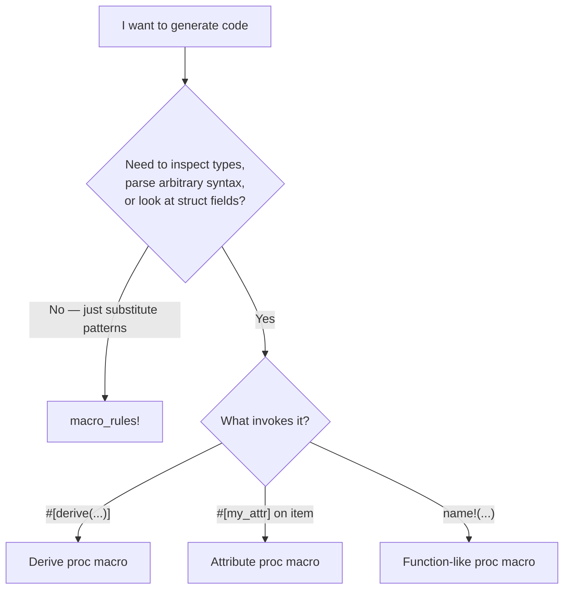

# Rust Macros — Declarative, Derive, and Procedural

## Why This Exists

**Problem.** Rust macros look like ordinary function calls (`vec!`, `println!`, `#[derive(Debug)]`) but the language underneath is its own thing — fragment specifiers, repetition syntax, hygiene rules, and a hard divide between "the easy one" (`macro_rules!`) and "the powerful but heavy one" (proc macros). Most tutorials treat macros as advanced and skip them; most people hit them on day one (because of `println!`) and don't realise there's a coherent system to learn.

**Key insight.** A macro is **a function from code to code, run at compile time.** That's it. Everything else — the weird `$x:expr` syntax, why proc macros live in their own crate, why `println!("hello")` won't accept a variable as the format string — falls out of that single fact.

**Reach for this when:**
- You see `vec![1, 2, 3]`, `println!("…", x)`, `#[derive(Debug)]`, `#[tokio::main]` and want to understand what they actually do
- You want to write your own `vec!`-style macro and don't know what `$($x:expr),*` means
- You're choosing between a function, a `macro_rules!`, and a proc macro
- You need to write `#[derive(MyTrait)]` for your library
- A macro is giving you a cryptic error and you want to see what it expanded to
- You hear "macro hygiene" and want to know what's hygienic about it

**Don't reach for this when:**
- You just want to *use* a macro — `vec!`, `println!`, derive macros from popular crates — that's a one-line lookup, not this note
- You want compiler-internal details (`proc_macro` ABI, span manipulation internals, build-script integration) — out of scope here
- You're solving a problem a function or generic would solve. Most "I need a macro" instincts are wrong — read §"When NOT to use a macro" first

---

## Table of Contents

- [§0. The Three Kinds at a Glance](#0-the-three-kinds-at-a-glance)
- [§1. Why Macros Exist (and What Functions Can't Do)](#1-why-macros-exist-and-what-functions-cant-do)
- [§2. Declarative Macros — `macro_rules!`](#2-declarative-macros--macro_rules)
- [§3. Fragment Specifiers and Repetition](#3-fragment-specifiers-and-repetition)
- [§4. Hygiene — Why Macros Don't Capture Your Variables](#4-hygiene--why-macros-dont-capture-your-variables)
- [§5. Procedural Macros — Overview](#5-procedural-macros--overview)
- [§6. Derive Macros — Writing `#[derive(MyTrait)]`](#6-derive-macros--writing-derivemytrait)
- [§7. Attribute and Function-like Proc Macros](#7-attribute-and-function-like-proc-macros)
- [§8. Debugging Macros](#8-debugging-macros)
- [§9. When NOT to Use a Macro](#9-when-not-to-use-a-macro)
- [Common Pitfalls](#common-pitfalls)
- [Decision Table](#decision-table)
- [References](#references)
- [See Also](#see-also)

---

## 0. The Three Kinds at a Glance

> *TL;DR — three kinds of macro, three different mental models. Pick by what you need to do, not by what's "more advanced."*

| Kind | Syntax to invoke | Where you define it | When to use |
|---|---|---|---|
| **Declarative** (`macro_rules!`) | `name!(...)`, `name![...]`, `name!{...}` | Inline, in any `.rs` file | DSL-like syntax sugar, variadic interfaces, repeated boilerplate |
| **Derive** | `#[derive(MyTrait)]` on a type | Separate `proc-macro = true` crate | Auto-implementing traits over user-defined types (`Debug`, `Clone`, `Serialize`) |
| **Attribute** | `#[my_attr]` on item | Separate proc-macro crate | Transforming an item (function, struct) — `#[tokio::main]`, `#[test]` |
| **Function-like proc** | `name!(...)` (looks like declarative!) | Separate proc-macro crate | Parsing custom syntax: `sqlx::query!`, `html!`, `regex!` with compile-time validation |

The split: **declarative macros pattern-match on token trees**; **procedural macros are arbitrary Rust functions that run at compile time and return tokens**. Proc macros are strictly more powerful but cost a separate crate, separate compile, and harder error messages.



---

## 1. Why Macros Exist (and What Functions Can't Do)

> *TL;DR — macros do things functions can't: variadic interfaces with different types, syntax that isn't a valid expression, compile-time code synthesis based on types/structure.*

A function with a fixed signature can't do what `println!` does. To see why, here are four jobs only macros can pull off:

### Variadic with mixed types

```rust
println!("{} {} {}", 1, "two", 3.0);
```

A regular function would need each `,`-separated arg to have the same type. `println!` accepts arbitrary types in arbitrary positions because it expands to a *different chunk of code* per call — type-checked at the call site.

### Compile-time invariants

```rust
let v: Vec<&'static str> = vec!["a", "b", "c"];
```

`vec![]` could be a function (`Vec::from`) — but `vec![0; 1000]` (a thousand zeros) compiles to a single allocation, not a `for` loop. The macro can pick the optimal expansion based on syntax.

### Constructs that aren't expressions

```rust
#[derive(Debug, Clone)]
struct User { name: String }
```

`#[derive(...)]` *adds* `impl` blocks to your module. A function can't add an `impl` — that's not even an expression.

### Compile-time validated literals

```rust
let q = sqlx::query!("SELECT * FROM users WHERE id = $1", id);
```

`sqlx::query!` parses the SQL string at compile time, checks it against the live database schema, and refuses to compile if the query is malformed. A function would only see a `&str` at runtime.

### Mental model

> **Macros let you write code that writes code.** They run before type checking, look at the syntax tree of their arguments, and produce a chunk of code that gets spliced in where the macro was called. Everything else — `$x:expr`, hygiene, `syn`/`quote` — is plumbing.

---

## 2. Declarative Macros — `macro_rules!`

> *TL;DR — `macro_rules!` is pattern-match-on-tokens, then substitute. Define `(pattern) => (template)` arms; the compiler picks the first arm whose pattern matches.*

### The smallest possible macro

```rust
macro_rules! say_hi {
    () => {
        println!("hi");
    };
}

fn main() {
    say_hi!();        // prints "hi"
}
```

Read it as: when `say_hi!()` is invoked with no arguments (the empty `()` pattern), substitute the template `{ println!("hi"); }`.

### Capturing a single value

```rust
macro_rules! shout {
    ($word:expr) => {
        println!("{}!!!", $word);
    };
}

shout!("hello");        // hello!!!
shout!(5 + 3);          // 8!!!
```

`$word:expr` says: "capture one expression and name it `$word`." Inside the template, `$word` is replaced with whatever was matched. `expr` is a **fragment specifier** — see §3 for the full list.

### Multiple arms

`macro_rules!` is *literally* a match — multiple arms tried top to bottom, first one wins:

```rust
macro_rules! greet {
    () => {
        println!("hello, stranger");
    };
    ($name:expr) => {
        println!("hello, {}", $name);
    };
    ($greeting:expr, $name:expr) => {
        println!("{}, {}", $greeting, $name);
    };
}

greet!();                    // hello, stranger
greet!("Alice");             // hello, Alice
greet!("hi", "Bob");         // hi, Bob
```

### Variadic with repetition: the `vec!`-style pattern

This is the everyday workhorse:

```rust
macro_rules! my_vec {
    ( $( $x:expr ),* ) => {
        {
            let mut v = Vec::new();
            $( v.push($x); )*
            v
        }
    };
}

let v = my_vec![1, 2, 3];   // Vec<i32> with 3 elements
```

Parsing the pattern:
- `$( ... )` — a repetition group
- `$x:expr` — inside the group, capture each item as an `expr` named `$x`
- `,` — items in the input are separated by commas
- `*` — match zero or more

In the template, `$( v.push($x); )*` says "for each captured `$x`, emit `v.push($x);`". The whole macro expands to:

```rust
{
    let mut v = Vec::new();
    v.push(1);
    v.push(2);
    v.push(3);
    v
}
```

### `macro_rules!` vs functions — the surface differences

```rust
my_macro!(x)       // call site (note the !)
my_macro![x]       // brackets allowed
my_macro!{x}       // braces allowed
```

The `!` distinguishes macros from functions at the call site. Brackets/braces/parens are interchangeable for *invocation*, though convention is `vec![...]` for collections, `println!(...)` for printf-style, `lazy_static! { ... }` for block-like DSLs.

### Exporting and importing

```rust
// In lib.rs or somewhere reachable
#[macro_export]
macro_rules! shout { ... }

// From another crate
use my_crate::shout;
shout!("yo");
```

`#[macro_export]` makes the macro available at the crate root (regardless of the module it's defined in). Without it, a macro is local to its module.

---

## 3. Fragment Specifiers and Repetition

> *TL;DR — fragment specifiers (`expr`, `ident`, `ty`, …) say what kind of syntax to match. `$(...)sep* / + / ?` are the three repetition shapes.*

### Fragment specifiers — what you can match

The compiler refuses to substitute arbitrary tokens because it needs to know how to re-parse them. Each `$x:KIND` constrains what `KIND` is allowed:

| Fragment | Matches | Example |
|---|---|---|
| `expr` | an expression | `1 + 2`, `vec![1]`, `foo(bar)` |
| `ident` | an identifier | `my_var`, `User`, `i32` (as a name) |
| `ty` | a type | `i32`, `Vec<T>`, `&'a str`, `Box<dyn Fn()>` |
| `pat` | a pattern | `Some(x)`, `(a, b)`, `_` |
| `path` | a path | `std::vec::Vec`, `crate::foo::Bar` |
| `stmt` | a statement | `let x = 5;`, `do_thing();` |
| `block` | a `{ ... }` block | `{ a; b; c }` |
| `item` | a top-level item | a `fn`, `struct`, `impl`, `mod` |
| `meta` | the inside of an attribute | what's between `#[` and `]` |
| `literal` | a literal | `42`, `"hi"`, `'a'`, `3.14` |
| `vis` | a visibility (incl. empty) | `pub`, `pub(crate)`, *(nothing)* |
| `lifetime` | a lifetime | `'a`, `'static` |
| `tt` | a single **token tree** — *the escape hatch* | any single token or matching-bracketed group |

You won't memorise all of these. The three you'll reach for 90% of the time are `expr`, `ident`, and `ty`. `tt` is the "I'll figure out the structure later" wildcard — useful when you want to forward arbitrary tokens through.

### The three repetition shapes

```
$( inner )sep?       // 0 or 1 — optional
$( inner )sep*       // 0 or more
$( inner )sep+       // 1 or more
```

The `sep?` is an *optional* separator (most often `,`); the trailing `*` / `+` / `?` is the count.

Examples in the wild:

```rust
// vec!-style: comma-separated, any number
macro_rules! list { ( $( $x:expr ),* ) => { ... }; }

// hashmap-style: pairs separated by commas
macro_rules! map {
    ( $( $k:expr => $v:expr ),* ) => { ... };
}

// optional trailing else clause
macro_rules! either {
    ( $cond:expr => $a:expr $( , else $b:expr )? ) => { ... };
}
```

### Repetition in the template

The expansion side mirrors the pattern side. Whatever was captured `$(...)*` is emitted `$(...)*` — and the compiler enforces that the number of repetitions agrees:

```rust
macro_rules! pairs {
    ( $( $k:expr => $v:expr ),* ) => {
        $(
            println!("{} = {}", $k, $v);
        )*
    };
}

pairs!("a" => 1, "b" => 2, "c" => 3);
// expands to three println! calls
```

You can nest repetitions, but you'll usually stop at one level — nested macros get unreadable fast.

### Why fragment specifiers matter — a worked failure

```rust
macro_rules! double {
    ($x:expr) => { $x * 2 };
}

let y = double!(1 + 2);
// expands to: 1 + 2 * 2  (= 5, NOT 6)
```

The macro substituted the *expression* `1 + 2`, but `*` has higher precedence than `+`, so `1 + 2 * 2` parses as `1 + (2 * 2)`. **Fix:** wrap captured `expr`s in parentheses if you're going to combine them with operators:

```rust
macro_rules! double {
    ($x:expr) => { ($x) * 2 };
}
```

This is the macro-author's version of "always parenthesise C macro args" — same hazard, same fix.

---

## 4. Hygiene — Why Macros Don't Capture Your Variables

> *TL;DR — identifiers introduced by a macro live in their own scope; they can't shadow names at the call site. This is the single most surprising thing about Rust macros to people coming from C.*

### The hazard `macro_rules!` avoids

In C, this looks innocent and is broken:

```c
#define SWAP(a, b) { int tmp = a; a = b; b = tmp; }

int tmp = 99;
SWAP(tmp, x);    // expands to { int tmp = tmp; tmp = x; x = tmp; }
```

The `tmp` introduced by the macro collides with the caller's `tmp`. `SWAP` silently does the wrong thing.

### In Rust, this doesn't happen

```rust
macro_rules! swap {
    ($a:expr, $b:expr) => {
        let tmp = $a;
        $a = $b;
        $b = tmp;
    };
}

let mut tmp = 99;
let mut x = 1;
swap!(tmp, x);
// the `tmp` in the macro is a DIFFERENT `tmp` than the caller's
// no collision, swap works correctly
```

**Identifiers introduced inside a macro live in a private scope.** They can't shadow or be shadowed by names at the call site. Rust calls this **hygiene** — the macro doesn't "contaminate" the caller's namespace.

### What hygiene doesn't cover

Hygiene is about *identifier scope*, not *behavior*. The macro can still:

- Refer to items from the call site through fragments you pass in (`$x`)
- Refer to absolute paths (`::std::vec::Vec`) — these resolve at the call site
- Cause type errors when expanded — those *do* show up at the call site

A common idiom: paths in macro bodies use `$crate::` to refer to "the crate where this macro was defined," so the macro keeps working when imported into another crate:

```rust
#[macro_export]
macro_rules! my_thing {
    () => { $crate::internal::helper() };
}
```

Without `$crate::`, the macro expansion would look up `internal::helper` *at the call site*, which probably doesn't have it.

---

## 5. Procedural Macros — Overview

> *TL;DR — proc macros are Rust functions that take tokens, return tokens, and run at compile time. They live in a separate `proc-macro = true` crate. Three flavours: derive, attribute, function-like.*

### Why a separate crate

A proc macro is *compiled* and *run* during the compilation of your main crate. The compiler needs to load it as a dynamic library before it can finish your build. So:

```toml
# in proc_macro_crate/Cargo.toml
[lib]
proc-macro = true

[dependencies]
syn = { version = "2", features = ["full"] }
quote = "1"
proc-macro2 = "1"
```

The three standard dependencies:

- **`proc-macro2`** — re-exportable token types
- **`syn`** — parses tokens into Rust's AST (`syn::ItemStruct`, `syn::ItemFn`, `syn::Expr`, …)
- **`quote`** — turns an AST/expression back into tokens via the `quote! { ... }` macro

### The workflow

```rust
use proc_macro::TokenStream;
use syn::{parse_macro_input, DeriveInput};
use quote::quote;

#[proc_macro_derive(Hello)]
pub fn derive_hello(input: TokenStream) -> TokenStream {
    // 1. Parse the input tokens into an AST
    let ast = parse_macro_input!(input as DeriveInput);
    let name = &ast.ident;

    // 2. Build the output tokens with quote!
    let expanded = quote! {
        impl Hello for #name {
            fn hello() {
                println!("Hello from {}", stringify!(#name));
            }
        }
    };

    // 3. Return as TokenStream
    TokenStream::from(expanded)
}
```

Read `quote! { ... }` as "produce these tokens literally, but substitute `#name` with the AST node bound to `name`." It's the proc-macro counterpart to `macro_rules!`'s `$name`.

### How the three flavours differ

Same machinery, different annotations:

```rust
#[proc_macro_derive(MyTrait)]        // invoked as #[derive(MyTrait)]
pub fn derive_my_trait(_: TokenStream) -> TokenStream { ... }

#[proc_macro_attribute]               // invoked as #[my_attr(args)]
pub fn my_attr(attr: TokenStream, item: TokenStream) -> TokenStream { ... }

#[proc_macro]                         // invoked as my_macro!(...)
pub fn my_macro(input: TokenStream) -> TokenStream { ... }
```

Note the function signatures:

- Derive takes the *type definition* (one `TokenStream`).
- Attribute takes the *attribute args* (`attr`) **and** the *item it annotates* (`item`).
- Function-like takes only the invocation arguments.

Attribute macros can **replace** the item, not just add to it. `#[tokio::main]` swaps your `async fn main` for an ordinary `fn main` that boots a Tokio runtime around it.

---

## 6. Derive Macros — Writing `#[derive(MyTrait)]`

> *TL;DR — derive macros generate `impl` blocks for your type. They get the type's AST as input and emit one or more `impl`s as output.*

A walkthrough: a derive macro that implements a trivial `Hello` trait.

### Project structure

```
my_derive/
├── Cargo.toml         # the proc-macro crate
├── src/lib.rs         # the derive impl
my_derive_tests/
├── Cargo.toml         # consumer crate
├── src/main.rs        # uses #[derive(Hello)]
```

Proc-macro crates can't contain anything *but* proc macros, and consumers can't run them as ordinary code. That's why they live separately.

### `my_derive/Cargo.toml`

```toml
[package]
name = "my_derive"
version = "0.1.0"
edition = "2024"

[lib]
proc-macro = true

[dependencies]
syn = "2"
quote = "1"
proc-macro2 = "1"
```

### `my_derive/src/lib.rs`

```rust
use proc_macro::TokenStream;
use quote::quote;
use syn::{parse_macro_input, DeriveInput};

#[proc_macro_derive(Hello)]
pub fn derive_hello(input: TokenStream) -> TokenStream {
    let DeriveInput { ident, .. } = parse_macro_input!(input);
    let expanded = quote! {
        impl Hello for #ident {
            fn hello() {
                println!("Hello from {}", stringify!(#ident));
            }
        }
    };
    TokenStream::from(expanded)
}
```

### Consumer

```rust
// my_derive_tests/src/main.rs
use my_derive::Hello;     // import the derive macro

trait Hello { fn hello(); }

#[derive(Hello)]
struct Cat;

#[derive(Hello)]
struct Dog;

fn main() {
    Cat::hello();    // "Hello from Cat"
    Dog::hello();    // "Hello from Dog"
}
```

### Iterating over struct fields

Most real derive macros want to look at the fields. The pattern:

```rust
let DeriveInput { ident, data, .. } = parse_macro_input!(input);
let fields = match data {
    syn::Data::Struct(s) => s.fields,
    _ => panic!("only structs supported"),
};

let names: Vec<_> = fields.iter().map(|f| &f.ident).collect();
let expanded = quote! {
    impl Describe for #ident {
        fn describe(&self) {
            #(
                println!("  {}: {:?}", stringify!(#names), self.#names);
            )*
        }
    }
};
```

The `#( ... )*` inside `quote!` is the proc-macro analogue of `$( ... )*` in `macro_rules!` — repeat the inner template, splicing each captured value.

### Real-world examples

- `thiserror::Error` — looks at enum variants, generates `Display` and `Error` impls
- `serde::Serialize` / `Deserialize` — walks struct fields, emits serialisation code
- `clap::Parser` — generates a CLI parser from struct fields

Reading their source (`syn`-based) is the best follow-up tutorial once you've written a small one.

---

## 7. Attribute and Function-like Proc Macros

> *TL;DR — attribute macros transform the item they annotate. Function-like proc macros are `macro_rules!`'s big sibling — used when pattern matching isn't expressive enough.*

### Attribute macros

```rust
#[proc_macro_attribute]
pub fn timed(_attr: TokenStream, item: TokenStream) -> TokenStream {
    let input = parse_macro_input!(item as syn::ItemFn);
    let sig = &input.sig;
    let name = &sig.ident;
    let block = &input.block;

    quote! {
        #sig {
            let start = std::time::Instant::now();
            let result = #block;
            eprintln!("{} took {:?}", stringify!(#name), start.elapsed());
            result
        }
    }.into()
}
```

Use it:

```rust
#[timed]
fn slow_thing() -> u32 {
    std::thread::sleep(std::time::Duration::from_millis(100));
    42
}
```

The annotated function is *replaced* — that's the difference from derive. After expansion, only the new body exists; the original `slow_thing` isn't compiled separately.

Real-world: `#[tokio::main]` (wraps in runtime), `#[test]` (registers as test), `#[axum::debug_handler]` (better error messages for Axum handlers).

### Function-like proc macros

```rust
#[proc_macro]
pub fn make_answer(_input: TokenStream) -> TokenStream {
    "fn answer() -> u32 { 42 }".parse().unwrap()
}
```

Invoke as `make_answer!();` — and an `answer` function appears.

These exist for **custom syntax that `macro_rules!` can't parse cleanly**:

- `sqlx::query!("SELECT name FROM users WHERE id = $1", id)` — parses SQL, validates it against your DB schema at compile time
- `html! { <div>{ name }</div> }` (in Yew, Leptos) — JSX-like syntax
- `regex!("^[a-z]+$")` (in some crates) — compile the regex at build time

These all parse arbitrary token streams that aren't valid Rust expressions until expansion, which `macro_rules!` cannot do.

---

## 8. Debugging Macros

> *TL;DR — `cargo expand` is your best friend. Bad pattern matches give cryptic errors; expansion failures show up at the use site with confusing line numbers.*

### `cargo expand` — see the expanded code

The single most useful tool. Install:

```bash
cargo install cargo-expand
```

Run on your crate:

```bash
cargo expand
cargo expand --bin my_app
cargo expand path::to::module
```

Shows your code with every macro fully expanded. Essential when a macro produces a confusing error — you can see the actual code the compiler tried to compile.

### `trace_macros!` (declarative only)

Inside a nightly-only feature, but worth knowing:

```rust
#![feature(trace_macros)]
trace_macros!(true);
my_macro!(args);
trace_macros!(false);
```

Prints each macro expansion step. Useful for recursive `macro_rules!`.

### `dbg!` and `eprintln!` inside proc macros

Proc macros are ordinary Rust functions, so `dbg!` works during compilation:

```rust
#[proc_macro_derive(Hello)]
pub fn derive_hello(input: TokenStream) -> TokenStream {
    dbg!(&input);                // prints during compile
    eprintln!("got input");
    // ...
}
```

Output goes to `cargo`'s stderr.

### Common error shapes

- **"unexpected end of input"** in a `macro_rules!` — your pattern has a `$( ... )*` that didn't terminate where you thought.
- **"expected expression, found `let`"** — you wrote `$x:expr` but passed a `let` statement; use `$x:stmt`.
- **"local ambiguity"** — two arms in the macro have overlapping patterns. Reorder so the more specific arm comes first.
- **A proc-macro panic** — the proc macro itself crashed. Compile error points at the call site, but the cause is in your proc macro code. Add `dbg!`/`eprintln!` and re-run.

---

## 9. When NOT to Use a Macro

> *TL;DR — most "I need a macro" instincts are wrong. Functions, generics, and traits should be your default. Macros are right when you genuinely need code-from-syntax.*

Macros are a last resort. They:

- Make IDE support worse (rename, jump-to-def, autocomplete)
- Produce error messages pointing inside the expansion, not your code
- Are harder to refactor than ordinary code
- Compile slower (proc macros especially)
- Resist documentation (`rustdoc` shows the macro signature, not the expansion)

**Use a function** when:
- Behaviour doesn't depend on the *type* or *syntax* of the arguments, only their values
- The number of arguments is fixed
- You can write it as `fn foo<T: Trait>(...)`

**Use a generic** when:
- You want one implementation working over many types
- The shared behaviour is captured by a trait bound

**Use a trait** when:
- Multiple types need related behaviour
- You want callers to pass any implementing type

**Use `macro_rules!`** when:
- You need variadic interfaces with mixed types (`println!`, `vec!`)
- You're writing a DSL that looks like data (`json!({...})`)
- You need compile-time string formatting / token shuffling

**Use a proc macro** when:
- You need to look at *types* or *struct fields* (derive)
- You're transforming an item (`#[tokio::main]`)
- You need custom syntax that isn't valid Rust until expansion (`sqlx::query!`)

If you're not sure, **try the non-macro version first.** Macros that exist because the author found a more elegant non-macro design are the best macros, because there aren't any.

---

## Common Pitfalls

- **`$x:expr` without parens around it in the expansion.** Operator precedence at the call site bites: `double!(1 + 2)` becomes `1 + 2 * 2 = 5`. **Fix:** wrap as `($x) * 2`.
- **Shadowing the caller's variable with a `let` inside the macro.** Doesn't happen in Rust thanks to hygiene — but newcomers from C/C++ often "fix" the wrong problem, e.g. `let __my_tmp__`. Hygiene already handles this; the underscores are redundant.
- **Forgetting `$crate::` in `#[macro_export]` macros.** Macro works in its home crate, breaks in consumers because `Vec` or `Result` doesn't resolve where they invoke it. **Fix:** `$crate::Vec`, `$crate::Result`.
- **Mixing `$x:expr` and `$x:tt` arbitrarily.** `expr` is parsed before substitution and keeps its structure; `tt` is a raw token tree. Use `expr` when you need an *expression* downstream; use `tt` when you want to forward unparsed tokens (often for recursive `macro_rules!`).
- **Reaching for a derive macro to add a method, not implement a trait.** That's an attribute macro's job — `#[my_attr]` can add methods, derives only add `impl Trait for Type`.
- **Panicking in a proc macro for user errors.** A panic produces a useless error at the call site. Use `syn::Error::new(span, "...").to_compile_error()` to emit a proper diagnostic.
- **Forgetting `proc-macro = true` in `Cargo.toml`.** Compile error like "found `pub fn` where macro expected" — your crate isn't being treated as a proc-macro crate.
- **Putting a derive macro and its consumer in the same crate.** Doesn't work — proc macros must be in a separate crate. **Fix:** split the project into `my_lib_macros` (proc-macro) and `my_lib` (re-exports + everything else).
- **Macro hygiene confusing you when you *want* to capture.** `macro_rules!` hygiene is mostly opaque — if you need to introduce a name visible to the caller, take it as a fragment: `let_in!(x = 5, x + 1)`. Proc macros have manual span control if you need it (`Span::call_site()`).
- **Slow compiles from heavy derives.** `serde`, `clap`, large `thiserror` enums, custom proc macros that touch many types — each one runs at every build. **Mitigation:** `cargo expand`-and-vendor the expanded code for the hot path, or use `proc-macro2`'s caching, or split crates so the derive recompiles less often.

---

## Decision Table

| Scenario | Use | Not | Why |
|---|---|---|---|
| `vec![]`-style variadic collection literal | `macro_rules!` | function | mixed-type args, no fixed arity |
| `printf`-style formatter | `macro_rules!` | function | compile-time format-string checking |
| Auto-implement a trait for many user types | derive proc macro | `macro_rules!` | needs to walk struct fields |
| Wrap `async fn main` in a runtime | attribute proc macro | derive | transforms the item, not just adds `impl` |
| DSL that looks like JSON / HTML / SQL | function-like proc macro | `macro_rules!` | custom syntax, compile-time validation |
| Same logic, multiple primitive types | generic with trait bound | macro | functions are simpler and IDE-friendly |
| Same logic, fixed arg count | function | macro | macros add no value here |
| Need to inspect struct fields by name | derive proc macro | `macro_rules!` | `macro_rules!` can't see types |
| Compile-time validated SQL/regex | function-like proc macro | runtime check | catches errors at build time |
| Macro should work across crates | `#[macro_export]` + `$crate::...` paths | bare paths | path resolution happens at call site |

---

## References

### Primary
- [The Rust Reference — Macros](https://doc.rust-lang.org/reference/macros.html) — the spec
- [The Rust Book — Macros chapter](https://doc.rust-lang.org/book/ch20-05-macros.html) — official intro to all three kinds
- [The Little Book of Rust Macros](https://veykril.github.io/tlborm/) — *the* definitive `macro_rules!` reference
- [`syn` documentation](https://docs.rs/syn) — proc-macro parsing
- [`quote` documentation](https://docs.rs/quote) — proc-macro codegen
- [`proc-macro2` documentation](https://docs.rs/proc-macro2)

### Tutorials and patterns
- [Rust by Example — Macros](https://doc.rust-lang.org/rust-by-example/macros.html)
- [`proc-macro-workshop`](https://github.com/dtolnay/proc-macro-workshop) — hands-on exercises from David Tolnay (author of `syn`, `quote`, `serde`)
- [`cargo-expand`](https://github.com/dtolnay/cargo-expand) — see what your macros expand to

### Source-reading recommendations
- [`thiserror`](https://github.com/dtolnay/thiserror) — small, well-documented derive macro
- [`serde_derive`](https://github.com/serde-rs/serde/tree/master/serde_derive) — the canonical large derive macro
- [`tokio-macros`](https://github.com/tokio-rs/tokio/tree/master/tokio-macros) — `#[tokio::main]` and friends

## See Also

- [rust-fundamentals](rust-fundamentals.md) — covers what macros are *used for* (`Box<dyn FnOnce() + Send + 'static>` as a thread-pool job type, `#[derive(thiserror::Error)]` in §5, `#[tokio::main]` in §12) without explaining how they're built. This note is the "how they're built" side.
